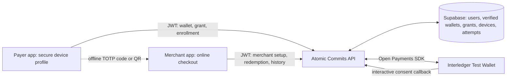

# Payment architecture

The Flutter app uses two independent Atomic Commit accounts. Each account can link one verified Test Wallet address. The payer enrolls a device after the provider approves a bounded spending grant. The merchant receives funds through the verified wallet linked to their own account.

The editable diagram is [backend-payments.mmd](backend-payments.mmd). The [sprint tracker](SPRINT_TRACKER.md) distinguishes code from verified behavior.

## Credentials and ownership

- The app uses a two-hour JWT for API authentication. Secure storage holds the token and the associated user together. The backend verifies the JWT for online requests. Logout removes the local session; there is no server-side JWT revocation.
- The backend uses its own developer signing key for the Open Payments SDK. The key is separate from each user's wallet and never enters the Flutter app.
- A subject-based interactive provider grant verifies the wallet address before the backend writes `verified_wallets`. Metadata discovery by itself does not establish ownership.
- A separate outgoing-payment grant holds the payer's spending permission. The backend encrypts provider credentials with `DATA_ENCRYPTION_KEY` and applies the per-payment limit locally. Provider tokens can expire or rotate.
- The backend returns a TOTP secret once during device enrollment. Flutter stores it in platform secure storage under the API origin and user ID. The payer can generate a code without a network request. Offline status cannot reveal a later server-side revocation.

## Payment state

The merchant's authenticated account selects its receiving wallet. The backend verifies the code, claims it once, reserves budget, requests an incoming payment and quote, then submits at most one outgoing payment. It reads the provider's outgoing and incoming resources before marking the attempt successful. The confirmed payer debit, recipient amount, assets, wallet IDs and resource references must match.

The merchant remains online. A timeout or unclear response remains `UNKNOWN` or `PROCESSING`; the claim and budget remain held. Reconciliation uses provider reads and does not resubmit a debit. A missing outgoing payment in a provider listing is not proof that no debit occurred.

`payment_attempts` stores records and receipts. Those records and grant allowance are not a wallet balance. Use the provider dashboard for balance information. Open Payments does not define a universal balance endpoint in its [API reference](https://openpayments.dev/overview/getting-started/).

## Boundaries

The implementation restricts provider addresses to HTTPS endpoints under `*.interledger-test.dev`. It is a Test Wallet demonstration, not a general production wallet integration. Camera scanning is not connected; the checkout accepts the human-readable code. The older signed-voucher CLI proofs are separate from the app's TOTP flow.
