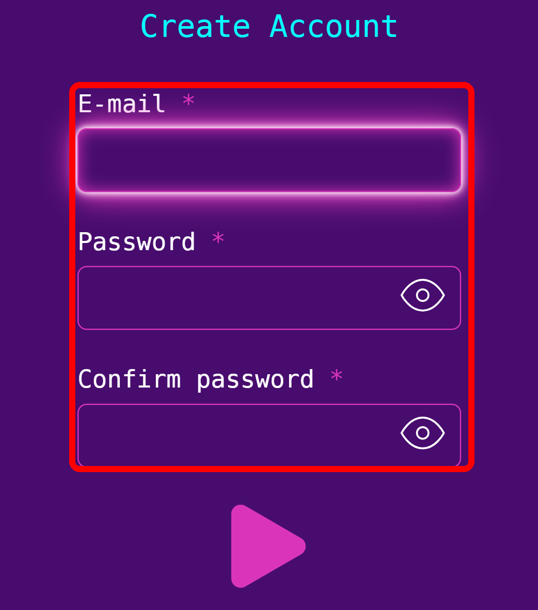
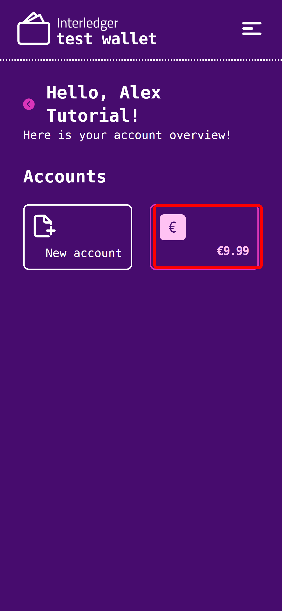
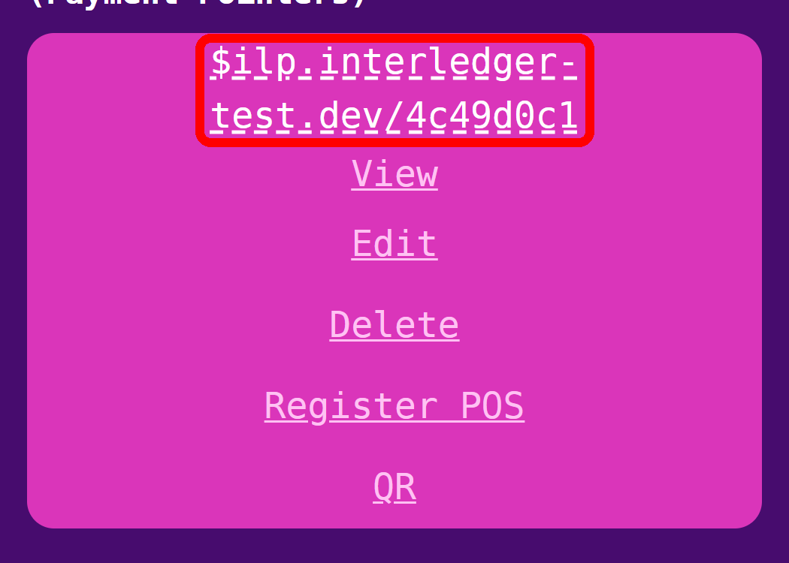
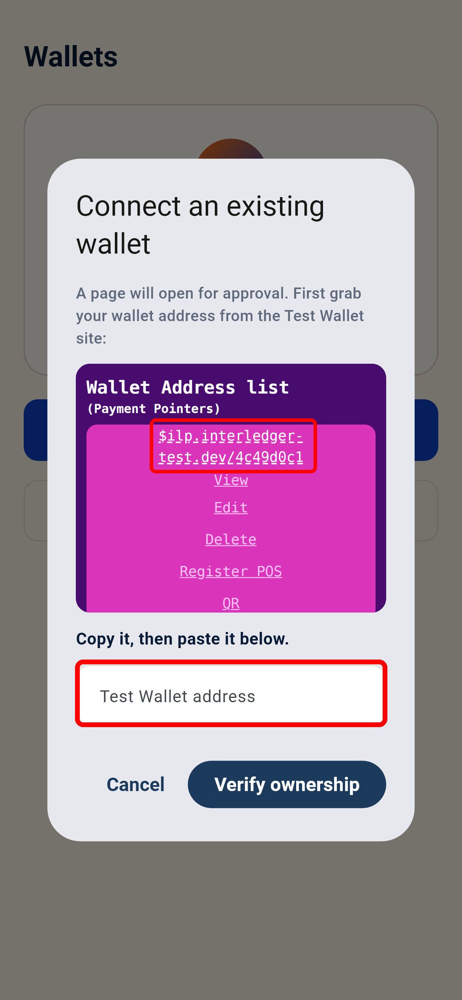

# Create a wallet on the Interledger Test Wallet

A short walkthrough from a fresh sign-up to a working `$ilp` wallet address you can connect in the app. Red boxes mark the fields and controls to use.

You need an email inbox you control and can access, plus about 10 minutes. Use your own unique password. This is a sandbox wallet, but the email must be yours so you can receive the verification link.

## 1. Navigate and fill in

Go to <https://wallet.interledger-test.dev> and fill in the sign-up form. Enter an email address and a password of at least 8 characters:

## 2. Use your own email

Enter **your own email address**, one whose inbox you can open to receive a verification message. Create a password of at least 8 characters and select the submit arrow. **Do not copy an email address from a screenshot or use somebody else's inbox.**

## 3. Open your account

On the dashboard, select your account card (boxed) to open it:

## 4. Confirm and verify

Open the confirmation email and tap the link, then follow the identity check. It takes about 10 minutes.

## 5. Copy your wallet address

On the account page, scroll to **Wallet Address list (Payment Pointers)**. The red box shows the `$ilp` value to copy:

Your address has the form `$ilp.interledger-test.dev/<id>`. The id differs for every account.

## Connect it in the app

In the app, open the wallet screen and select **Connect an existing wallet**. A two-step guide shows where to open the account and which address to copy. Paste your address into the field, then select **Verify ownership**:

A page opens for approval. Approve it in the Test Wallet site, then return to the app. The wallet screen lists your wallet as verified.

## What you built

You now hold a sandbox account with its own `$ilp` payment pointer, and the app shows that wallet as verified. The same address works anywhere on the Interledger test network.
