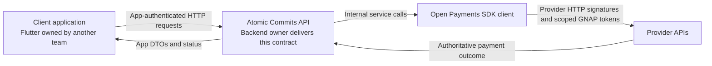
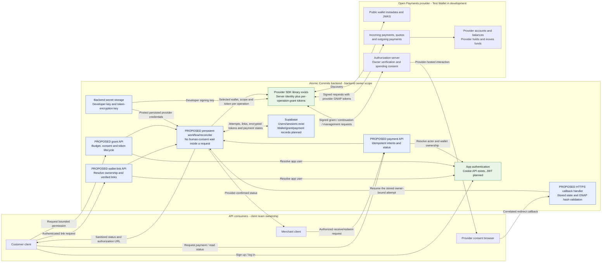
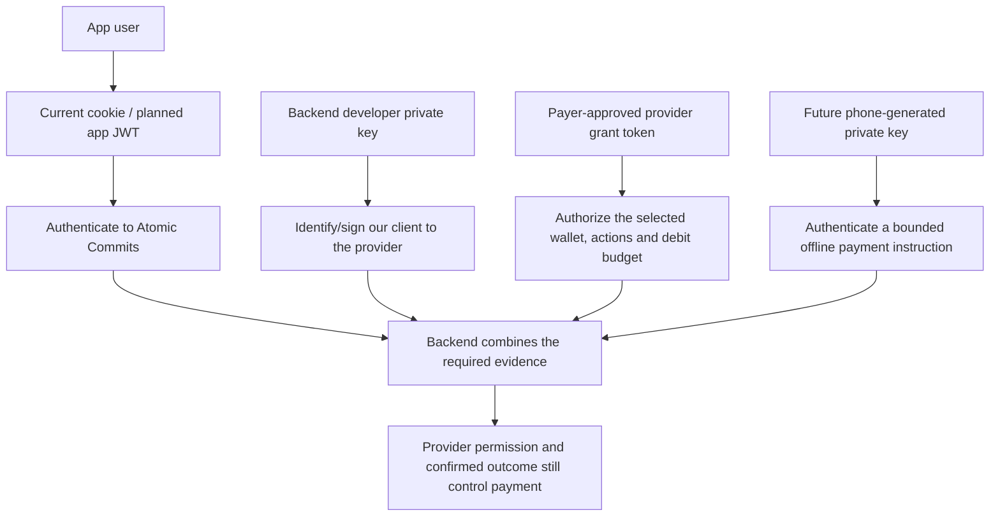
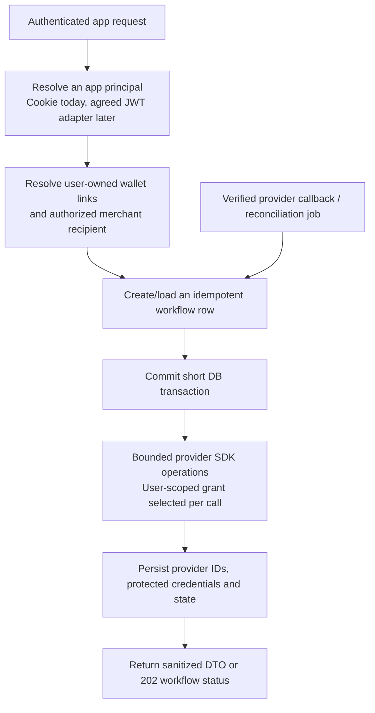
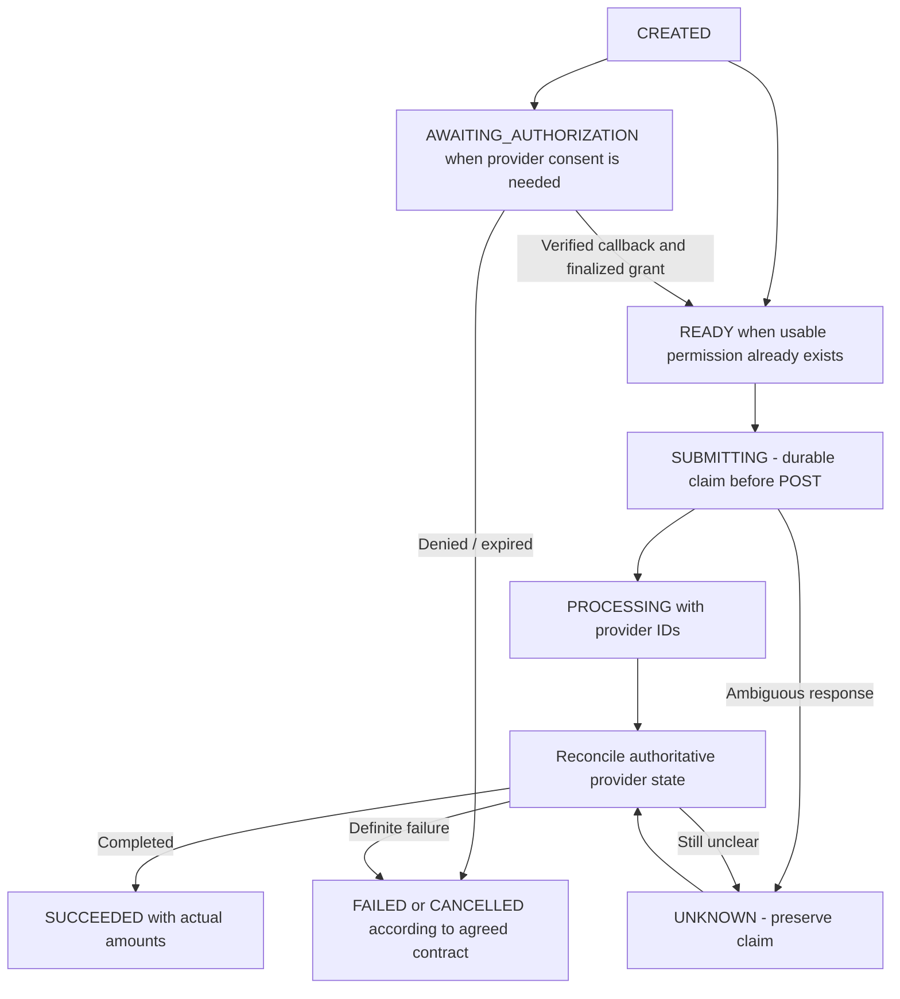
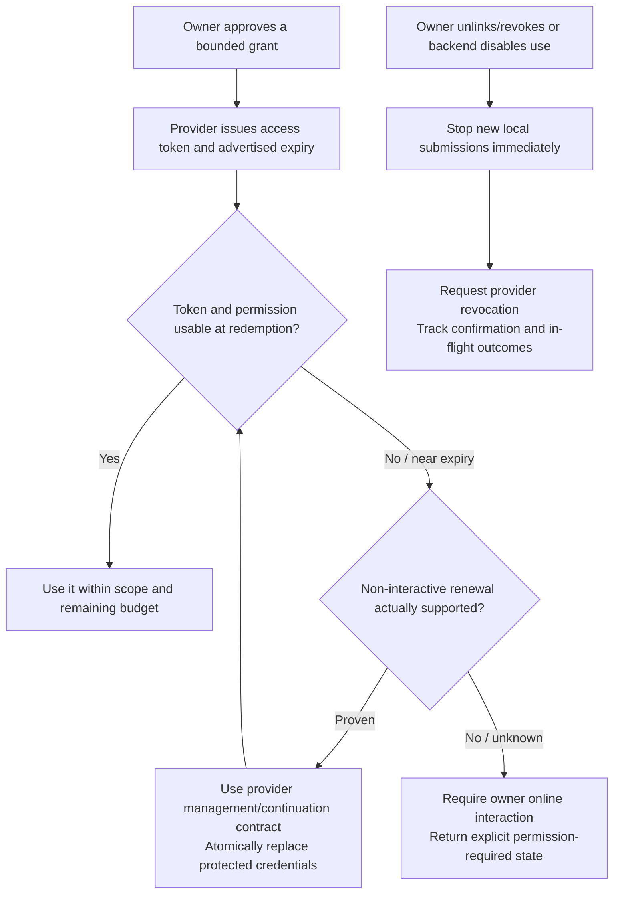
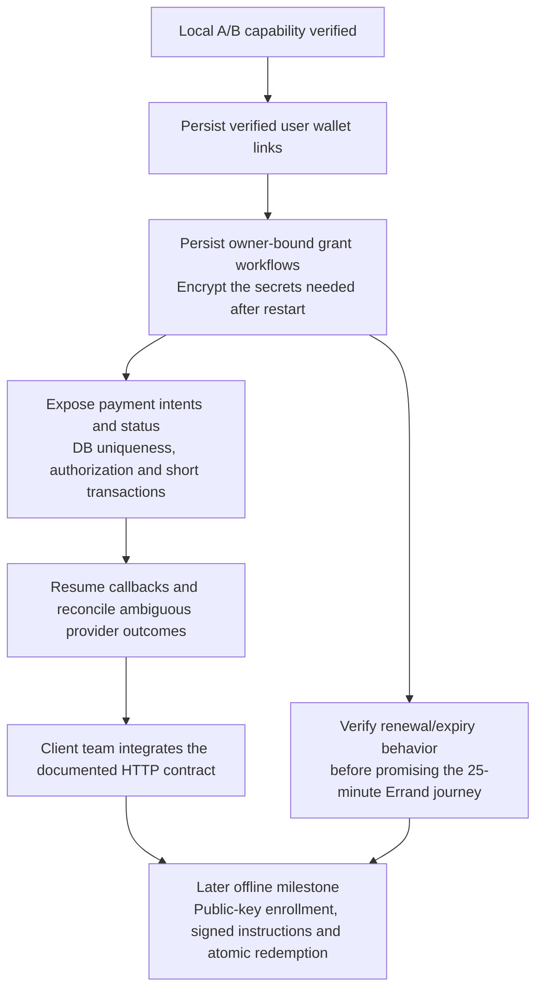

# Backend payments: architecture and API boundary

> Open Payments makes digital payments interoperable. Atomic Commits makes them accessible when the payer has no internet connection, using short-lived payment codes, pre-authorized spending limits and online merchant verification.

## Reading map

| Document                                                | Purpose                                                                                   |
| ------------------------------------------------------- | ----------------------------------------------------------------------------------------- |
| This document                                           | Architecture, implementation internals, proposed API/data/token contracts, open decisions |
| [Standalone architecture Mermaid](backend-payments.mmd) | The component flowchart as a native `.mmd` file                                           |
| [Proofs and theory](payment-proofs.md)                  | Why A/B exist, exact observations and empirical limits such as the 600-second token       |
| [Reproduction guide](payment-reproduction.md)           | Backend-only setup, keys/tokens, consent, commands and recovery                           |
| [Product flowcharts](payment-flows.md)                  | Customer/merchant journeys for online and offline payments                                |
| [Detailed sequence](payment-flows.mmd)                  | End-to-end interactions and current development notes                                     |

## 1. Implementation status

| Status                  | Meaning                                                                       | Examples                                                                                                   |
| ----------------------- | ----------------------------------------------------------------------------- | ---------------------------------------------------------------------------------------------------------- |
| Implemented             | Code exists and runs today                                                    | Auth endpoints, wallet metadata lookup, developer client factory, CLI proofs                               |
| Verified in development | Observed against Interledger Test Wallet on 23 October 2026 (simulated funds) | Proof A transfer, Proof B grant reuse and budget rejection, 600-second advertised token expiry             |
| Proposed                | Drafted for the client contract; not implemented                              | Wallet-link/grant/payment endpoints, persistent workflow records, device enrollment and offline redemption |

Everything labeled proposed needs design agreement and implementation before clients can use it. Do not describe proposed functionality as already implemented when communicating with the client team or the provider.

## 2. Do we expose an API?

**Yes. Atomic Commits is a backend API consumed by client applications.** There are two distinct API boundaries:



The SDK is an internal provider connector. Client applications call our authenticated endpoints; they never receive our developer private key or provider grant tokens. Public wallet metadata does not establish an account balance, and remaining grant allowance is spending permission, not available funds; a live-balance capability requires a separately supported and authorized provider contract.

### Current implementation baseline

| Area                         | Current implementation                                                                        |
| ---------------------------- | --------------------------------------------------------------------------------------------- |
| Runtime                      | Node/TypeScript, CommonJS package, TypeScript `Node16` module resolution, ES2022 target       |
| HTTP server                  | Express; JSON bodies capped at 10 KB; Helmet; auth rate limiting                              |
| App authentication           | BCrypt passwords, `express-session`, `connect-pg-simple`, `atomic.sid` cookie                 |
| Database                     | PostgreSQL hosted on Supabase; `pg` pool; SQL migrations executed by `backend/src/migrate.ts` |
| Provider library             | `@interledger/open-payments` 7.4.0 in the lockfile                                            |
| Provider scope               | Interledger Test Wallet, simulated funds                                                      |
| Payment execution            | Local developer CLI only; Proof A and B passed for the configured pair                        |
| Payment API                  | Not yet mounted in `src/app.ts`                                                               |
| Durable payment/grant tables | Not yet created                                                                               |
| Offline credentials          | Device enrollment, signature verification, nonce redemption and QR API not yet implemented    |

The existing `app_private.users.id` is an **integer identity**, not a UUID. Existing tables are `users`, `session` and the migrator's `schema_migrations` ledger. New workflow rows can use UUIDs while referencing the existing integer app-user ID. Migrations currently use one `DATABASE_URL` with a `pg_advisory_xact_lock` inside an explicit transaction; the migration/runtime connection split is deferred in [issue #3](https://github.com/MasieJr/Atomic-Commits/issues/3) and is not a prerequisite for app API work.

### Current HTTP API: implemented

These routes are mounted by `backend/src/app.ts` and `src/routes/auth.ts`:

| Method | Route                | Current behavior                                                              |
| ------ | -------------------- | ----------------------------------------------------------------------------- |
| GET    | `/health`            | Health response, including when auth configuration is absent                  |
| POST   | `/api/auth/register` | Validate name/email/password, BCrypt hash, create app user and cookie session |
| POST   | `/api/auth/login`    | Verify credentials and regenerate a PostgreSQL-backed cookie session          |
| GET    | `/api/auth/me`       | Current app user, protected by the session middleware                         |
| POST   | `/api/auth/logout`   | Destroy the app session and clear its cookie                                  |

Auth uses the `atomic.sid` cookie today. JWT is planned in [issue #4](https://github.com/MasieJr/Atomic-Commits/issues/4). Missing DB/session configuration produces auth HTTP 503; supplying a Bearer token does not currently turn these routes into JWT routes.

### Current payment integration: local commands

`wallet:lookup`, `payment:proof-a`, `payment:proof-b` and `payment:proofs` are CLI entry points. They do not create app-facing payment routes. The proof's `http://localhost:3999/callback/<random-value>` listener exists only while a proof is awaiting consent; it is not part of the main API on port 3000.

**Wallet-link, payment-grant, payment-status, device-enrollment and redemption endpoints remain proposed.** Section 7 drafts that contract.

## 3. Backend architecture target

Green components identify existing foundations. Blue components contain proposed application integration; the Supabase node includes existing auth tables but its payment-related records are still planned.



The provider holds and moves funds. The backend authorizes operations, obtains provider permission, initiates instructions and records/reconciles outcomes. Supabase is the app's record store, not an invented customer funds ledger.

## 4. Ownership of the work

| Backend owner                                                   | Client team                                                                 | Provider                                                |
| --------------------------------------------------------------- | --------------------------------------------------------------------------- | ------------------------------------------------------- |
| Authenticated API and authorization                             | Screens, forms and navigation                                               | Provider account opening and funding                    |
| Verified wallet links and callback state                        | Enter/select wallet addresses and open consent URLs                         | Wallet metadata and ownership/spending consent          |
| Protected grant tokens and lifecycle handling                   | Store the app login credential appropriately                                | Issue scoped access tokens and enforce grant limits     |
| Amount/asset checks, idempotency and reconciliation             | Submit requests and display returned states                                 | Execute payment instructions and expose outcomes        |
| Later: enroll public device keys and verify signed instructions | Later: generate/retain the phone's offline private key and sign QR payloads | Remain authoritative for permission and available funds |

The backend owner defines the client contract and the public-key/payload formats. Implementing Flutter secure storage or UI is not part of that backend scope.

## 5. Four different identities/credentials



These four credentials are not interchangeable. Provider resource APIs use `Authorization: GNAP <provider-token>` plus SDK request signing; planned app JWTs would use `Authorization: Bearer <app-token>` toward our API; the current app auth uses its cookie. The full inventory, including lifetimes and exposure rules, is in the [reproduction guide](payment-reproduction.md).

## 6. Provider integration internals

### SDK foundations: `backend/src/services/open-payments.ts`

| Method/setting                     | Behavior and integration implications                                                                                                                           |
| ---------------------------------- | --------------------------------------------------------------------------------------------------------------------------------------------------------------- |
| `clientOptions`                    | 10-second request timeout, silent SDK logging, provider OpenAPI response validation enabled                                                                     |
| `walletAddressUrl(value)`          | Normalize `$` pointers/HTTPS URLs, reject HTTP, embedded credentials and fragments. Bare pointers use `/.well-known/pay`. This is not a production SSRF defense |
| `requiredEnvironment(name)`        | Require trimmed backend configuration                                                                                                                           |
| `createOpenPaymentsClient()`       | Return a new authenticated SDK client using client wallet, key ID and private-key path. This is a factory, not a cached singleton                               |
| `lookupWalletAddresses(addresses)` | Normalize inputs and concurrently fetch public metadata through an unauthenticated SDK client                                                                   |

A production composition root may reuse a client per integration credential set. Never store a user's provider token as shared mutable client configuration; SDK operations receive tokens per call.

The constructor's client wallet identifies the **integration**. The payer wallet supplied when creating a quote or outgoing payment selects the **source account**. These roles are distinct even though the demo borrows the payer wallet for the developer identity.

### Callback protocol: `backend/src/services/grant-interaction.ts`

| Method                         | Behavior                                                                                                                                                                                                   |
| ------------------------------ | ---------------------------------------------------------------------------------------------------------------------------------------------------------------------------------------------------------- |
| `testWalletUrl(value)`         | Restrict proof operations to HTTPS `*.interledger-test.dev` endpoints, without embedded credentials/fragments or nonstandard ports                                                                         |
| `verifyInteractionHash(...)`   | Canonically decode padded Base64 or Base64url and compare the expected SHA-256 digest bytes in constant time                                                                                               |
| `requestInteractiveGrant(...)` | Start a loopback-only HTTP listener; create nonce/state; request explicit consent; verify one callback; respect continuation wait values; continue until finalized or bounded timeout; clean up on failure |

The GNAP interaction hash input is:

```text
clientNonce
providerNonce
interact_ref
exact initial grant-request URI
```

joined by LF characters with no trailing LF. The digest is SHA-256, decoded and compared as 32 bytes in constant time.

The current helper requires an interactive result. An app implementation must model legitimate finalized/non-interactive results according to the actual requested operation and provider policy. The reusable concept is hash calculation and strict response handling; the development-only mechanism is a new localhost server plus an in-process promise per interaction. The public API instead needs persisted owner-bound interaction state and an ordinary HTTPS callback route (section 7).

### Provider mechanics: `backend/src/services/payment-proof.ts`

| Method                           | Behavior                                                                                                                                                                               |
| -------------------------------- | -------------------------------------------------------------------------------------------------------------------------------------------------------------------------------------- |
| `PaymentProofs.create`           | Read the two temporary wallet env values, fetch metadata, require distinct addresses, validate Test Wallet endpoints and initialize the signing client                                 |
| `initializeResourceGrants`       | Obtain incoming `create/read/complete` and quote `create/read` grants; stop if those require unsupported extra interaction                                                             |
| `receiveAmount` / `budgetAmount` | Pair configured minor-unit strings with recipient/payer metadata respectively                                                                                                          |
| `rememberGrant`                  | Track in-memory tokens for redaction and later grant cancellation                                                                                                                      |
| `prepare`                        | Create a fresh incoming payment, then quote; record resource references and quoted amounts                                                                                             |
| `createQuote`                    | Validate payer, receiver, positive amounts and matching assets/scales. Normal transfers use a fixed receive amount; the negative probe uses a fixed debit                              |
| `authorize`                      | Request bounded outgoing permission, optionally receiver-bound (Proof A); verify actions/payer/returned limits and record advertised token expiry                                      |
| `requireLiveGrant`               | Stop when an advertised token is expired or within a five-second safety margin; no implicit outgoing-token rotation                                                                    |
| `refreshQuote`                   | Replace a near-expiry quote for the existing incoming payment; later budget checks still apply                                                                                         |
| `pay`                            | Refresh if needed, check grant lifetime and remaining budget, then submit                                                                                                              |
| `submitAndConfirm`               | Persist `SUBMITTING` before POST, call outgoing creation once, capture provider ID; distinguish definite HTTP rejection from an ambiguous result                                       |
| `confirm`                        | Poll outgoing and incoming resources, verify references/assets/amounts, require completed receipt and full send; retain partial amounts on failure and mark unresolved cases `UNKNOWN` |
| `spent`                          | Read the provider's outgoing-grant spent debit amount, validating asset/scale                                                                                                          |
| `probeBudget`                    | Deliberately exercise Test Wallet's aggregate cap. A relevant denial only passes with a usable token and unchanged provider counter                                                    |
| `cleanup`                        | Cancel tracked temporary grants; retain outgoing authority when a payment is unresolved and record cleanup warnings                                                                    |

Do not mount this class directly as a multi-user payment controller. It reads global demo wallets, assumes one operator and keeps grant credentials in memory; there is no database-backed customer payment workflow inside it. `confirm` currently requires `failed === false`, sent amount equal to debit, matching quote/resource IDs, and a completed incoming receipt meeting the expected receive amount. Adapt confirmation to each supported provider's documented authoritative semantics; never replace it with HTTP 201 or a local success flag.

### Local evidence: `backend/src/services/payment-proof-run.ts`

- `readProofConfig` rejects production mode and validates the proof's amount/port/time settings.
- `minorValue` uses `BigInt` with nonnegative integer strings of at most 18 digits; `sameAsset` requires code and scale; `formatAmount` formats without floating-point arithmetic.
- `ProofStepError` preserves the failing protocol step and original error.
- `ProofRun.start` creates an exclusive file lock and refuses a previous unresolved attempt.
- `rememberSecret`, `redact`, `json` and `safeError` keep known tokens/nonces out of persisted evidence and diagnostics.
- `step` persists the current stage and checks interruption before an operation.
- `save` uses temporary-file/rename writes for the run and latest snapshot; `writeReceipt`/`readReceipt` manage successful A/B receipts.
- `finish` classifies the overall run; `close` releases its file lock.

These are operator aids. JSON receipts and `active.lock` are not production authorization, distributed idempotency or a recovery database. If the process dies, the provider credentials needed for automated reconciliation are not recoverable from those receipts.

### CLI orchestration: `backend/src/commands/payment-proof.ts`

- `proofA` prepares one fixed-receive payment, obtains receiver-bound quoted permission, confirms the payment and writes its receipt.
- `waitForSpent` waits for the provider counter to equal the sum of confirmed quoted debits.
- `performProofB` obtains a receiver-unbound budget grant before fresh incoming resources, holds the same outgoing token through two payments, then runs the budget rejection check.
- `proofB` records an explicit capability result and failure/fallback details.
- `main` runs `a`, `b` or `both`, manages interruption and cleanup, and never invokes the app's HTTP payment API.

The A/B hypotheses, observed results and the exact scope of that evidence are in the [proofs document](payment-proofs.md); how to run them is in the [reproduction guide](payment-reproduction.md).

## 7. Proposed API contract (not implemented)

These draft paths use the existing `/api` convention. They are a contract proposal to agree with the consumer team, not available routes.

| Method | Proposed route                            | Actor and purpose                                                                 |
| ------ | ----------------------------------------- | --------------------------------------------------------------------------------- |
| POST   | `/api/wallet-links`                       | Signed-in user starts linking a public wallet address                             |
| GET    | `/api/wallet-links`                       | Current user's links and public metadata                                          |
| GET    | `/api/wallet-links/{id}`                  | Owner polls link status                                                           |
| DELETE | `/api/wallet-links/{id}`                  | Owner unlinks; affected permission/revocation policy must be applied              |
| POST   | `/api/payment-grants`                     | Wallet owner requests a bounded provider spending grant                           |
| GET    | `/api/payment-grants/{id}`                | Owner reads scope, state, advertised expiry and allowance metadata                |
| DELETE | `/api/payment-grants/{id}`                | Owner requests revocation; do not claim remote revocation before confirmation     |
| POST   | `/api/payments`                           | Authorized payer starts an idempotent online payment                              |
| GET    | `/api/payments/{id}`                      | Authorized payer/recipient reads sanitized outcome                                |
| GET    | `/api/open-payments/callback/{attemptId}` | Provider browser redirect resumes a persisted attempt using protocol verification |

The callback cannot require the provider's browser redirect to carry our app JWT. It must validate stored one-use state plus the GNAP digest, then resume the owner already recorded on the attempt. Any app return URI must be allowlisted. Return an opaque workflow reference to the client; keep provider access/continuation tokens on the backend.

For current app auth, reuse `requireLogin` and `req.session.userId` through a small principal adapter. Bearer app JWT handling is still [issue #4](https://github.com/MasieJr/Atomic-Commits/issues/4); keep payment ownership resolution independent of the credential transport. Before web-client integration, agree CORS/credential policy and trusted-proxy/TLS behavior; CORS middleware is not currently configured.

### Draft wallet-link request and response

```json
{ "walletAddress": "$ilp.interledger-test.dev/<customer-wallet>" }
```

Proposed HTTP 202 response after creating a persisted interaction:

```json
{
  "walletLinkId": "<opaque-id>",
  "status": "AWAITING_PROVIDER",
  "authorizationUrl": "<provider-hosted-https-interaction-url>",
  "expiresAt": "<workflow-expiry>"
}
```

The backend fetches asset metadata and binds the link to the authenticated user; the request body does not select an arbitrary app-user ID. Return a whitelist of app fields rather than reflecting raw SDK metadata containing provider-specific extras such as internal `cardService` URLs. The public wallet-address API supplies no account balance; do not fill a balance DTO from a mockup value or from remaining grant allowance.

### Draft payment request and response

Use an `Idempotency-Key` header with a user-scoped uniqueness constraint: the same key plus the same request returns the existing attempt; the same key plus a different request is a conflict.

```json
{
  "payerWalletLinkId": "<owned-verified-link-id>",
  "recipientMerchantId": "<verified-merchant-id>",
  "receiveAmount": { "value": "10", "assetCode": "EUR", "assetScale": 2 },
  "maxDebitAmount": { "value": "500", "assetCode": "ZAR", "assetScale": 2 }
}
```

The service resolves the recipient wallet from an authorized merchant record. Client-supplied IDs must pass ownership/access checks; they are not authority by themselves.

Proposed HTTP 202 response, with `Location: /api/payments/<payment-id>`:

```json
{
  "paymentId": "<opaque-id>",
  "status": "AWAITING_AUTHORIZATION",
  "quotedDebitAmount": { "value": "185", "assetCode": "ZAR", "assetScale": 2 },
  "receiveAmount": { "value": "10", "assetCode": "EUR", "assetScale": 2 },
  "authorizationUrl": "<provider-interaction-url-when-needed>"
}
```

The example amounts reflect the observed experiment; the service obtains a real quote. A reusable grant can avoid a new interaction when valid, but never avoids user/merchant authorization or budget checks. A later GET returns `PROCESSING`, `SUCCEEDED`, `FAILED` or `UNKNOWN` as appropriate, with actual amounts and partial-result information.

### Draft error/status semantics

Keep the existing auth error shape intact. A payment-specific additive error DTO can be agreed as:

```json
{
  "error": "Provider permission needs renewal",
  "code": "GRANT_REAUTHORIZATION_REQUIRED",
  "paymentId": "<existing-attempt-id>"
}
```

- 400: malformed input; 401: missing/invalid app auth; 403: app authorization/permission refusal.
- 404: unknown/inaccessible resource according to the agreed resource-privacy policy.
- 409: idempotency mismatch, already-claimed credential, or invalid workflow transition.
- 422: understood request whose asset/amount/lifetime constraints cannot be met.
- 202: pending workflow, required provider action, or asynchronous processing.
- A provider timeout after outgoing submission must preserve the existing payment ID and `UNKNOWN` state. Do not invite a fresh debit by presenting it as an ordinary retriable validation failure.

Provider HTTP 403 is not automatically an app-auth error. The proof's over-budget 403 is tightly contextual; normal payment denials remain failures.

### Service request flow and boundaries



Follow the existing routes/controllers/services/models structure. Controllers validate/authorize and delegate; provider orchestration, transactional ownership checks and reconciliation belong in services/repositories, not in a long-held HTTP request waiting for human consent. At minimum introduce:

1. Wallet-link service: URL normalization plus DNS/redirect/private-network protections, provider metadata, subject verification and owner-bound records.
2. Interaction-state service: persisted nonces, grant endpoint, protected continuation token, purpose, owner, expiry and one-use completion.
3. Grant service: payer binding, encrypted secrets, access/limits, advertised expiry, spent counter, management/revocation/renewal state.
4. Payment service: fresh provider resources, exact money/asset rules, idempotent attempts, authoritative confirmation and ambiguous-outcome recovery.

An in-process worker backed by PostgreSQL can be enough for the hackathon. An external queue is an implementation choice, not an excuse to leave human-interaction or recovery state only in memory.

## 8. Persistent workflow and data model proposal

No tables below exist yet. Suggested responsibilities:

| Record                                      | Required information                                                                                                                                                                       |
| ------------------------------------------- | ------------------------------------------------------------------------------------------------------------------------------------------------------------------------------------------ |
| `wallet_links`                              | UUID, existing integer `user_id`, normalized provider wallet ID, asset/scale, provider metadata, status, verification timestamps/default selections                                        |
| `provider_interactions`                     | UUID, owner, purpose, wallet/grant/payment references, client/provider nonces, exact grant URI, protected continuation data, expiry, consumed state and allowed return URI                 |
| `payment_grants`                            | Owner + payer link, provider grant/reference, scopes, requested/accepted budget, interval when present, token expiry, management references, state, encrypted credential references        |
| `payment_attempts`                          | UUID, initiator/payer/recipient ownership, idempotency key + request fingerprint, incoming/quote/outgoing IDs, quoted/actual amounts with assets/scales, state and reconciliation metadata |
| `provider_credentials` or encrypted columns | Resource/outgoing/continuation tokens needed to resume and reconcile after a restart, with encryption key version and authenticated-encryption metadata                                    |
| Later: `devices`, `redemptions`             | Owner-bound public keys and revocation; unique device/nonce claims and linked payment attempt                                                                                              |

Use DB uniqueness for idempotency and nonce claims. Hold transactions around short state changes, then commit before network calls. Store money as exact integers (an agreed `numeric(...,0)` representation) and serialize as strings; do not introduce floating-point arithmetic.

Encrypt persisted provider secrets with a dedicated backend secret-storage/encryption design. Do not derive that encryption key from a user's password hash or repurpose the app session secret, developer signing key or phone signing key. Public wallet addresses/public keys need integrity and ownership controls; they are not private signing credentials.



This is a proposed app state model, not the existing enum. The proof's `PaymentEvidence.state` currently uses `PREPARED`, `SUBMITTING`, `PROCESSING`, `SUCCEEDED`, `FAILED`, `UNKNOWN`, and negative-probe `REJECTED`.

Do not reset `UNKNOWN` to a new submission. Reconcile by recorded resource IDs and retain the read authority required for recovery. Provider-side idempotency-header support remains unverified. Definite failure can still contain partial amounts; agree the customer/merchant handling before automatic retries or refunds.

## 9. Token lifecycle and renewal (not implemented)



The installed SDK exposes `client.token.rotate({ url, accessToken })` and `client.token.revoke({ url, accessToken })`; token-management calls use the provider-returned `access_token.manage` URI and the required token. Those methods exist, but their usable timing and consent requirements have not been demonstrated against this deployment. The proofs cancel grants through `client.grant.cancel` using the continuation URI/token.

Do not assume that `expires_in` controls the overall grant lifetime, that changing the local consent timeout changes provider expiry, or that an expired token can be rotated without interaction. Persist the management/continuation credentials and metadata only when their exact provider contract is established. The empirical 600-second observation and its consequence for the 25-minute Errand target are in the [proofs document](payment-proofs.md).

## 10. Deferred offline API contract

Potential later endpoints are an authenticated device-enrollment challenge, device public-key enrollment/revocation, and `POST /api/qr-redemptions`. These are proposals, not existing routes.

The client team generates the phone key. The backend validates an agreed proof-of-possession challenge and stores only the public verification key, owner, device ID and revocation metadata. Backend registration must never create or reuse a provider developer key as a customer's phone key.

The shared offline payload contract must authenticate version, mode, payer alias/device ID, asset/scale, debit ceiling, issued-at, expiry, nonce and any merchant restriction. Agree the canonical bytes and encoding with the client team before implementation; Quick is at most 30 seconds, Errand at most 1500 seconds, using server time and a defined clock-skew policy.

At redemption, app authentication identifies the merchant. The enrolled key/signature identifies the payer instruction. The backend resolves the merchant's verified receiving link, claims the device/nonce atomically, quotes the actual purchase, enforces the signed debit ceiling plus provider limits, and confirms the provider outcome. A payer app JWT is not expected to arrive from an offline payer at that step.

A six-digit value cannot carry the full signed offline instruction. Any short human-readable reference needs a separately defined online-preissued, server-backed design. Do not port the static HTML demo code as a real authorization mechanism.

## 11. Open decisions requiring product/provider answers

Ask these as product/provider decisions, not assumptions to silently implement:

| Priority | Question                                                                                                                                                      | Why current evidence does not settle it                                                              |
| -------- | ------------------------------------------------------------------------------------------------------------------------------------------------------------- | ---------------------------------------------------------------------------------------------------- |
| 1        | Can the backend keep usable permission for a 25-minute Errand without the payer reconnecting? What rotation/continuation works before and after token expiry? | Observed access-token expiry is 600 seconds; renewal was not exercised                               |
| 2        | Until renewal is proven, should the allowed credential lifetime be bounded by remaining usable provider permission, or should the UI require reauthorization? | A valid signature cannot make an expired provider token usable                                       |
| 3        | Does one app-owned integration identity work for unrelated payers and multiple merchant wallets?                                                              | Demo identity was borrowed from the payer; both B payments used the same recipient wallet            |
| 4        | Are we promising true offline generation, or offline presentation of an earlier server-issued reference?                                                      | These require different storage, enrollment and UX contracts                                         |
| 5        | Can an Errand QR be redeemed by any verified merchant, or should merchant binding be required when known?                                                     | Receiver was omitted from the grant, but a second merchant and bearer-paper risks were not tested    |
| 6        | How will real customers obtain and fund an eligible provider account? Is manual external setup acceptable for the hackathon?                                  | Test Wallet signup/KYC/funding is external; automatic provider account opening is unverified         |
| 7        | Which wallet/currency is default, and is the signed ceiling the payer's total debit including FX/fees?                                                        | The demonstrated ZAR/EUR quote is not a general pricing/cap UX contract                              |
| 8        | Do users explicitly confirm any suggested R5 buffer, and does one successful redemption consume all remaining credential allowance?                           | The backend must not silently raise a cap or turn unused change into a new authorization             |
| 9        | What should happen when several offline authorizations exceed the live balance/grant allowance in aggregate?                                                  | Offline creation does not reserve funds or know current provider spending                            |
| 10       | What is the merchant/customer UX for UNKNOWN, partial payment, lost connectivity and later confirmation?                                                      | Preventing a second debit requires a durable state and recovery policy                               |
| 11       | How are lost/replaced phones revoked and re-enrolled, and who owns the canonical signing/payload format?                                                      | No device enrollment or cross-platform signature flow exists yet                                     |
| 12       | What is the minimal stable API contract the client team needs first, and who owns the JWT migration?                                                          | Current HTTP exposure is auth/health; CLI proofs are not app endpoints                               |
| 13       | Does the vision require a live available balance, and which authorized provider API supplies it?                                                              | Public wallet metadata and the grant's remaining spending allowance are not account-balance evidence |

## 12. Implementation order



Sequential steps in service of that flow:

1. Agree the small wallet/grant/payment DTOs and a stable authenticated-principal adapter; this can start with current cookie auth.
2. Add wallet-link/interaction persistence and ownership-verification endpoints.
3. Add protected grant persistence and public metadata/status endpoints; investigate token renewal in parallel with the 25-minute decision.
4. Add idempotent online payment endpoints and restart-safe reconciliation.
5. Publish the API contract for the client team. Keep developer credentials and provider tokens server-side.
6. Add device public-key enrollment and signed redemption after the permission, money and payload contracts are settled.

Reuse the provider operations and confirmed observations. Replace the CLI's global wallet env inputs, file lock, process-local callback and JSON receipts with user-scoped persisted workflows; a small DB-backed worker can be sufficient for the demo, and a large distributed queue stack is not a prerequisite. For each increment, state what is implemented, what was manually verified and what remains assumed. The Test Wallet result is a strong capability signal for the next backend increment, not evidence that the entire offline product or a production bank integration is complete.

## References

- [Installed SDK's source/README](https://github.com/interledger/open-payments-node/tree/main/packages/open-payments) - check the local 7.4.0 types/lockfile before adopting newer examples.
- [Verify wallet-address ownership](https://openpayments.dev/guides/verify-wallet-address-ownership/) - the next wallet-link capability; verify the actual subject request/response schema with the installed SDK/provider.
- [Resource lifecycle](https://openpayments.dev/concepts/resources/) - incoming/quote/outgoing meaning and confirmation.

Guides describe capabilities, not proof that every provider deployment, lifecycle option or SDK version supports them.
