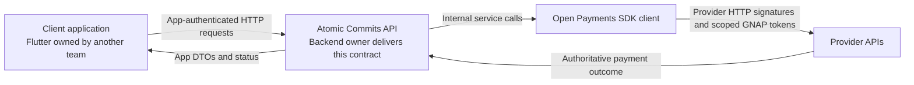
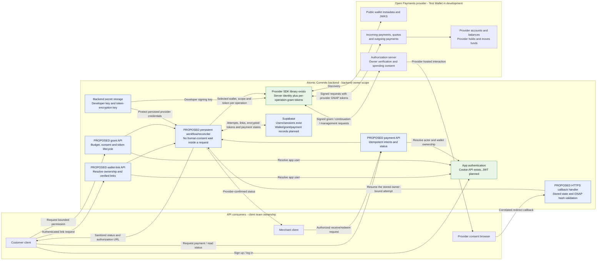
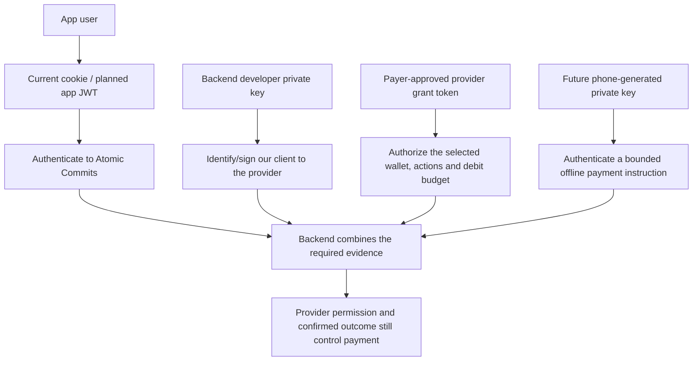
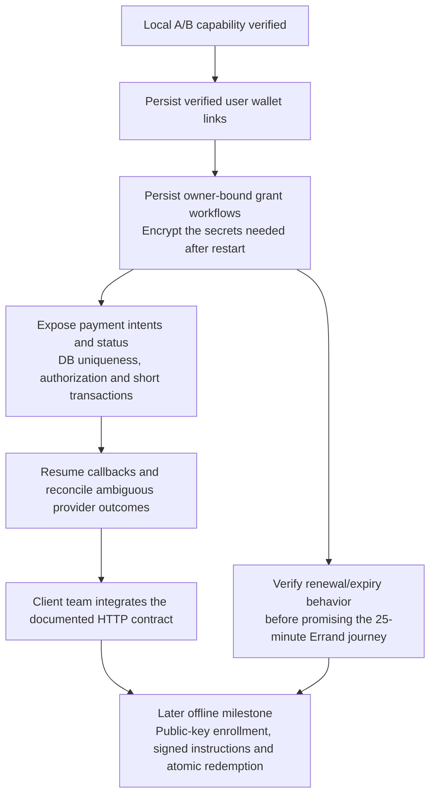

# Backend payments: architecture and API boundary

**Scope:** the project owner is responsible for the backend. Flutter/UI implementation belongs to the client team. These documents describe the backend services and the contract that clients will consume.

## Reading map

| Document | Purpose |
| --- | --- |
| This document | Architecture, responsibilities and current versus proposed API exposure |
| [Standalone architecture Mermaid](backend-payments.mmd) | The component flowchart as a native `.mmd` file |
| [Proofs and theory](payment-proofs.md) | Why A/B exist, exact observations and implications for the vision |
| Local agent handoff: `backend-agent-handoff.md` | Source-level notes and API drafts, kept locally rather than versioned |
| [Reproduction guide](payment-reproduction.md) | Backend-only setup, keys/tokens, consent, commands and recovery |
| [Product flowcharts](payment-flows.md) | Customer/merchant journey as a design reference |
| [Detailed sequence](payment-flows.mmd) | Intended end-to-end interactions and current development notes |

## 1. Do we expose an API?

**Yes. Atomic Commits is a backend API consumed by client applications.** There are two distinct API boundaries:

The SDK is an internal provider connector. Client applications should call our authenticated endpoints, not receive our developer private key or provider grant tokens.

### Current HTTP API: implemented

These routes are mounted by `backend/src/app.ts` and `src/routes/auth.ts`:

| Method | Route | Current behavior |
| --- | --- | --- |
| GET | `/health` | Health response, including when auth configuration is absent |
| POST | `/api/auth/register` | Validate name/email/password, BCrypt hash, create app user and cookie session |
| POST | `/api/auth/login` | Verify credentials and regenerate a PostgreSQL-backed cookie session |
| GET | `/api/auth/me` | Current app user, protected by the session middleware |
| POST | `/api/auth/logout` | Destroy the app session and clear its cookie |

Auth uses the `atomic.sid` cookie today. JWT is planned in [issue #4](https://github.com/MasieJr/Atomic-Commits/issues/4). Missing DB/session configuration produces auth HTTP 503; supplying a Bearer token does not currently turn these routes into JWT routes.

### Current payment integration: local commands

`wallet:lookup`, `payment:proof-a`, `payment:proof-b` and `payment:proofs` are CLI entry points. They do not create app-facing payment routes.

The proof's `http://localhost:3999/callback/<random-value>` listener exists only while a proof is awaiting consent. It is not part of the main API on port 3000 and is not a production callback endpoint.

**Wallet-link, payment-grant, payment-status, device-enrollment and redemption endpoints remain proposed.** The current route inventory is above; detailed endpoint/DTO drafts are kept in the local agent handoff.

## 2. Backend architecture target

Green components identify existing foundations. Blue components contain proposed application integration; the Supabase node includes existing auth tables but its payment-related records are still planned.

The provider holds funds. The backend authorizes operations, obtains provider permission, initiates instructions and records/reconciles outcomes. Supabase is the app's record store, not an invented customer funds ledger.

Public wallet metadata does not establish an account balance. Remaining grant allowance is spending permission, not available funds. A live-balance endpoint would need a separately supported and authorized provider capability.

## 3. Ownership of the work

| Backend owner | Client team | Provider |
| --- | --- | --- |
| Authenticated API and authorization | Screens, forms and navigation | Provider account opening and funding |
| Verified wallet links and callback state | Enter/select wallet addresses and open consent URLs | Wallet metadata and ownership/spending consent |
| Protected grant tokens and lifecycle handling | Store the app login credential appropriately | Issue scoped access tokens and enforce grant limits |
| Amount/asset checks, idempotency and reconciliation | Submit requests and display returned states | Execute payment instructions and expose outcomes |
| Later: enroll public device keys and verify signed instructions | Later: generate/retain the phone's offline private key and sign QR payloads | Remain authoritative for permission and available funds |

The backend owner defines the client contract and the public-key/payload formats. Implementing Flutter secure storage or UI is not part of that backend scope.

## 4. Four different identities/credentials

The backend SDK client can be reused across users, with wallet IDs and grant tokens supplied per operation. `createOpenPaymentsClient()` currently returns a new instance per call; it does not automatically cache one or create app users.

In development, the configured client identity/key is borrowed from the demo payer's Test Wallet. A dedicated backend integration identity acting for unrelated users remains a separate validation question.

## 5. Moving from CLI to API

Reuse the provider operations and confirmed observations. Replace the CLI's global wallet env inputs, file lock, process-local callback and JSON receipts with user-scoped persisted workflows. A small DB-backed worker can be sufficient for the demo; a large distributed queue stack is not a prerequisite.

The local agent handoff specifies the proposed resources, states and decisions. Those drafts still need to be agreed before they become an implemented API contract.
