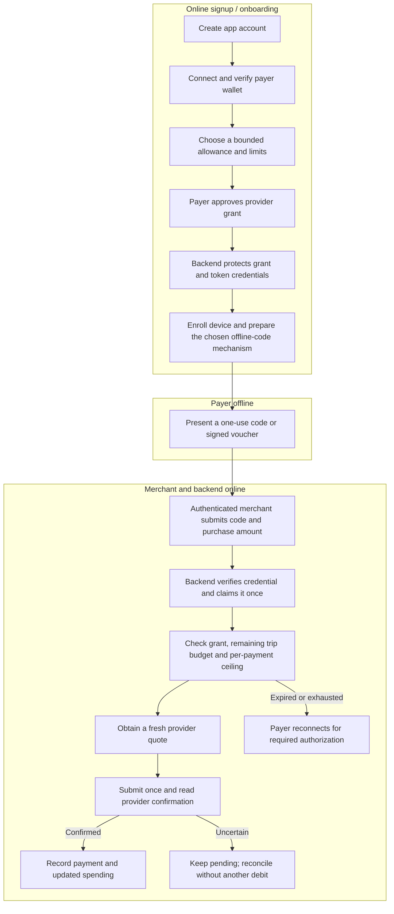

# Offline spending envelopes and signed instructions (L4/L5 draft)

This branch provides a backend policy, versioned instruction parser, Ed25519 verification and a reservation orchestration seam. A development-only Node sender and merchant simulator now connect that path to the existing Test Wallet payment service when explicitly run live. Settlement still requires an online merchant, backend and provider. The simulator is **not** an app API, database adapter, durable payment service or Flutter implementation.

The 2026-10-28 live Proof C run **PASSED** for the configured Test Wallet pair, with two rotations and a confirmed transfer after 25 minutes. This does not demonstrate offline-device redemption, durable recovery, other providers or real-money settlement. Offline spending must not be enabled solely because these checks pass.

### Live development voucher proof — 2026-10-28 UTC

The owner-approved **merchant-unbound** voucher proof also **PASSED** for the configured Test Wallet pair. It used one payer approval and a newly generated Ed25519 device key; a separate Node sender process, with ordinary Node network APIs disabled, signed a voucher containing no merchant binding. The online simulated merchant redeemed it through the existing provider payment service.

The provider accepted a **2.00 ZAR** trip grant and confirmed **one** payment: **1.86 ZAR sent** and **0.10 EUR received**. The initial fresh-grant counter was explicitly empty; after settlement the provider's numeric debit counter reported **1.86 ZAR**. The same signed voucher was rejected on replay without a second payment. Cleanup reported no warnings and no authorities retained for unresolved payments.

This is live provider evidence for a development Node simulator and an in-memory claim store. It is **not** an OS-level air gap, a physically offline phone, the six-character code, real merchant/app authentication, durable replay protection or production readiness.

### Four-payment trip attempt — 2026-10-28 UTC

An owner-approved attempt requested and received one **R500.00** outgoing grant with an **R50.00 per-payment** ceiling. The network-guarded sender created four merchant-unbound vouchers. **Two payments were provider-confirmed**, each sending R1.86 and receiving €0.10; the provider debit counter reached R3.72. The attempt stopped while requesting the recipient resource grant for the third payment, before a third outgoing debit. The original run did not retain a provider status or error code for that failure, so its cause is unknown. No payment remained unresolved, and cleanup reported no warnings or retained authorities. The overall four-payment objective is therefore **INCONCLUSIVE**, not passed.

The development adapter now reuses incoming-payment and quote grants while their provider-advertised lifetimes have a safe margin; unknown expiry is not assumed. It also records a sanitized preparation stage and provider status/code when available. These changes do not establish the cause of the earlier failure.

The separately approved retry **PASSED** under one new grant and one payer approval:

| Observation | Result |
| --- | --- |
| Provider-approved cumulative grant | **R500.00** |
| Development backend per-payment ceiling | **R50.00**; a signed R50.01 voucher was rejected locally before any provider quote |
| Confirmed payments | **Four distinct** payments; each sent **R1.86** and received **€0.10** |
| Provider debit counter | **R1.86 → R3.72 → R5.58 → R7.44**, matching the four confirmed debits |
| Sender and merchant | Four merchant-unbound vouchers signed in network-guarded Node sender processes; the online merchant simulator selected the recipient |
| Consent and replay | One initial payer approval, no further approval between payments; replay was rejected |
| Cleanup | No warnings and no authorities retained for unresolved payments |

The R50 per-payment rule above is enforced by our development policy, not a separate provider-issued per-transaction restriction. The provider grant carried the R500 cumulative debit limit. The proof did not send an over-R50 payment to the provider. The earlier failure was reported by the owner as rate limiting, but its provider status was not retained, so the precise cause was not independently confirmed.

## Grant and offline-code flow



The **grant** is provider-issued spending authority; the access token is a secret credential used to exercise it. The pooled code or signed voucher is a separate one-use checkout credential and must not contain provider tokens. A code pool cannot create new provider permission when none remains.

### What has—and has not—been established about duration

- Test Wallet advertised a **600-second access-token lifetime**. Proof C rotated tokens proactively and observed the same grant working beyond **25 minutes** without another payer interaction.
- A **one-month grant lifetime has not been verified**. Do not equate the token's 600-second expiry with the grant's overall lifetime, and do not assume it lasts indefinitely.
- A grant valid for one month with a **single R500 cumulative cap** is different from a grant that **resets to R500 each month**. The latter needs provider-supported recurring interval semantics and explicit user consent. Test Wallet returned one requested monthly interval in a no-payment probe, but actual monthly reset behavior is **not verified**, and the current payment-path validator rejects `interval` limits.
- The intended experience is a **fresh monthly spending allowance**, not a scheduled subscription payment: while the approved grant remains usable, the monthly allowance resets and a debit occurs only when an authorized purchase is redeemed. The allowance is a permission limit, not money added to the wallet; actual wallet funds and any per-payment ceiling still apply. Unused allowance does not roll over under the documented provider model.
- L6 remains undecided between pre-issued lookup codes and an authenticator-style prefix/code mechanism. Neither six-character mechanism was exercised by the Node signed-voucher proof above.

### Monthly interval investigation — 2026-10-28

The Open Payments [future-payment grant guide](https://openpayments.dev/guides/outgoing-grant-future-payments/) documents a recipient-unbound grant with a monthly cap and says unused funds do not carry over. The [spent-amounts documentation](https://openpayments.dev/sdk/outgoing-grant-spent-amounts/) says the reported amount for a recurring grant covers the **current interval**, rather than the entire life of the grant. The installed SDK describes `interval` as an ISO 8601 repeating interval. These are protocol and SDK descriptions, not observations of this Test Wallet deployment.

There is a finite-repeat discrepancy to resolve before deriving an expiry from the interval. The guide describes `R3/2025-05-20T13:00:00Z/P1M` as **three** monthly periods. In contrast, [Rafiki's pinned interval tests](https://github.com/interledger/rafiki/blob/31b3461defbaebec781e63ffd0491873d0a8aab3/packages/backend/src/open_payments/payment/outgoing/limits.test.ts) expect `R2/2022-07-01T13:00:00Z/P1M` to include July, August **and** September—three periods. Its [interval implementation](https://github.com/interledger/rafiki/blob/31b3461defbaebec781e63ffd0491873d0a8aab3/packages/backend/src/open_payments/payment/outgoing/limits.ts) starts with the initial period and then repeats it. It is unknown which version or interpretation the configured Test Wallet uses. Neither an echoed interval nor a token's `expires_in` establishes the grant's actual end date.

Until those semantics and the detailed period-boundary policy are established, the existing payment path remains fail-closed: an interval returned on a grant is rejected, and an unexpected decrease in spending across token rotation blocks the lifecycle. Recurring support would need exact request/returned-scope verification, an independently enforced validity window, provider-backed current-period identification, and safe handling of reservations and uncertain payments crossing a boundary. A period change must never silently discard an unresolved debit or convert a missing counter to zero.

**Prepared Test Wallet probe:** one new, recipient-unbound outgoing grant, requested at **R0.01 per monthly interval** with `R1/<current-UTC-start>/P1M`; one payer consent; **zero outgoing payments**. It records whether the request was finalized, rejected or unconfirmed, whether the returned cap and interval match, and an initial counter observation only when the entire expected scope matches. It attempts to cancel every finalized temporary grant even when inspection or the counter read fails. A request without a finalized response, or a failed cancellation, is reported as unresolved rather than assumed cleaned up. The probe contains no payment-submission path.

From `backend/`, `npm run payment:monthly-probe` is dry and performs no provider calls. **Only after separate owner approval**, `npm run payment:monthly-probe -- --live` runs the grant request, consent, optional counter read and cancellation above. The probe's finite `R1` interval is an intentionally bounded diagnostic, not the desired ongoing monthly-allowance policy. The guide and Rafiki source differ on whether `R1` describes one or two periods, so this request must not be represented as a verified one-month expiry. Immediate acceptance and cancellation cannot demonstrate long-term usability or a reset; those require separate evidence and approval.

On 2026-10-28, an owner-approved live no-payment probe requested the R0.01 monthly cap and the provider supplied a consent redirect. The execution harness did not deliver that link to the owner while the process was waiting, so the ten-minute consent window expired without an approval. The grant was not finalized, its returned scope and spent counter were not observed, and **no outgoing payment was made**. The interaction helper attempted cancellation of the unfinished request and reported no cleanup warning, but the run records cancellation as **unknown**, not independently verified. That attempt is **INCONCLUSIVE**.

The separately approved retry on **2026-10-28 at 18:09 UTC** finalized one recipient-unbound grant after one payer approval. Test Wallet returned exactly the requested **R0.01** debit cap and `R1/2026-10-28T18:09:26Z/P1M` interval, along with the expected payer and create/read scope. The initial provider spent-counter response was explicitly `null`/`null`, not a numeric zero. The grant-cancellation request returned successfully without a cleanup warning, and **zero outgoing payments** were made. The probe recorded **OBSERVED** for immediate scope and cleanup; this demonstrates acceptance of that request, not an actual debit, an interval-boundary reset, a one-month grant lifetime, or the finite-repeat interpretation.

### Onboarding ownership

- **Massi (Flutter):** after signup, guide the user through connecting/verifying their wallet and explicitly approving a bounded provider grant while online; show the total and per-payment limits, known validity and reauthorization status. Guide device enrollment and the eventual code-pool or authenticator setup, with clear offline/reconnect and pool-exhaustion states. Offline spending is enabled only after the backend confirms setup. Provider grant tokens must never be sent to the app.
- **Josue (J3A/J3B/J3C/J3D):** provide authenticated wallet-link and provider callback workflows, encrypted grant/rotation storage, durable payment and one-use claim/reservation handling, device enrollment and status APIs. Massi's screens consume those contracts rather than implementing payment authorization or provider-secret storage.

After this four-payment proof, the next provider-specific question is whether the grant can remain usable for a month and whether a monthly **reset** is supported. In parallel, the durable J3 integrations and Massi's onboarding can proceed; the original L6 code mechanism and its security review remain separate work.

## Enrollment and policy

`OfflineSpendingEnvelope` is an authoritative server-issued record independent of each device-created instruction. It binds the payer and verified wallet, provider authorization, device/key and revocation versions, payer asset, per-payment ceiling, cumulative cap, validity window, and optional merchant scope. It cannot widen the current grant. The earlier L3 `OfflineEnvelope` describes a credential containing an instruction; adapters must map these distinct types explicitly and must not treat one as an issued spending authorization.

`evaluateOfflineSpendingPolicy` consumes trusted, server-loaded snapshots of the enrollment, device, wallet, merchant, provider grant and quote. The provider authority snapshot has a server-controlled identity, observation time and bounded validity window; an absent, future-dated or expired snapshot is refused. It rejects unverified or revoked authority and devices, mismatched ownership or merchant bindings, expired/future-dated instructions and stale quotes. Server time is authoritative; this draft allows **zero clock skew**. The instruction and envelope must fit the grant's validity window.

All payer amounts use exact minor-unit strings, asset code and scale. The quote's **payer debit**, not merchant-receive units, must fit the signed ceiling and the remaining envelope/grant allowance. For the voucher proof, the accepted trip budget automatically supplies the signed ceiling; the payer does not set another ceiling at checkout. At redemption the reservation is narrowed to the lesser of the signed ceiling and remaining allowance after provider spending and outstanding reservations. An adapter must account for all potentially unsettled debits; overcounting is conservative, undercounting is unsafe.

Because the quote is obtained after reservation, a voucher whose ceiling is the entire trip budget can temporarily reserve all remaining allowance. Another simultaneous checkout may be refused until the first resolves; a confirmed debit releases unused reservation, while an unknown outcome remains held.

## Version 1 signed wire format

The QR carries an object with exactly `payload` and `signature`. The payload contains `version`, `envelopeId`, `authorizationId`, `instructionId`, `deviceId`, `keyVersion`, `nonce`, `issuedAtEpochMs`, `expiresAtEpochMs`, `assetCode`, `assetScale`, `maxDebitMinor`, and optional `merchantScopeId`. A **merchant-unbound ceiling voucher** omits both the merchant and exact purchase amount: the payer can choose the ceiling offline before deciding where to shop. The online merchant supplies the purchase amount at redemption; the provider quote's payer debit must fit the signed ceiling. The separate **exact-purchase** form carries `exactPurchase.merchantReceive` (`value`, `assetCode`, `assetScale`) and requires `merchantScopeId`. Unknown fields are rejected. Identifiers use printable ASCII without spaces, bounded to 256 characters. Monetary values are positive canonical integer strings of at most 18 digits. The nonce is canonical unpadded base64url encoding of 16–32 cryptographically random bytes and must never be reused.

`offlineInstructionSigningBytes` wraps the payload in L3's versioned canonical JSON and adds `purpose: "atomic-commits/offline-payment"`. Object keys sort recursively by UTF-8 bytes, with no insignificant whitespace; the version is bound in both the outer wrapper and payload. The signature is unpadded base64url of the 64-byte Ed25519 signature. The 32-byte public key is loaded from the trusted enrolled-device registry, **never from the QR**. Provider access tokens, continuations and device private keys must never be in the QR, logs or events.

### Public interoperability vector

The following is a public test fixture, not an enrolled device credential. UTF-8 encode the exact `canonicalUtf8` string to verify the signature with the public key:

```json
{
  "canonicalUtf8": "{\"body\":{\"assetCode\":\"USD\",\"assetScale\":2,\"authorizationId\":\"grant-1\",\"deviceId\":\"device-1\",\"envelopeId\":\"env-1\",\"expiresAtEpochMs\":1700000060000,\"instructionId\":\"instruction-1\",\"issuedAtEpochMs\":1700000000000,\"keyVersion\":\"key-1\",\"maxDebitMinor\":\"60\",\"merchantScopeId\":\"merchant-1\",\"nonce\":\"MDEyMzQ1Njc4OWFiY2RlZg\",\"purpose\":\"atomic-commits/offline-payment\",\"version\":\"1\"},\"version\":\"1\"}",
  "publicKey": "dZ3FNPiVCIIz92ye9xThyC7aHFheRaXpBVp3bmK-gFY",
  "signature": "qjetMd3QjV6TXJTo-G4Yesg1yX27xaqoH8NC01mCeWvDQBl1DxhpdTBfnME5KdHSeatVDuXPLeEVPKzVjPBZAw"
}
```

Ed25519 is a **draft interoperability choice**, not evidence of device security. [Dart cryptography](https://pub.dev/packages/cryptography) documents Ed25519 and a Dart fallback on Android; [cryptography_flutter](https://pub.dev/packages/cryptography_flutter) lists its native Ed25519 implementation for Apple platforms. [flutter_secure_storage](https://pub.dev/packages/flutter_secure_storage) documents encrypted storage, which does not establish that an Ed25519 private key is hardware-backed or non-exportable. The project has not installed or tested these libraries on a supported Android device. The Flutter owner must verify key custody, offline signing and byte-for-byte interoperability before choosing a production device implementation.

## Reservation boundary

`reserveSignedOfflineInstruction` receives the merchant identity from an authenticated server-side principal, loads the enrolled public key, and validates the device signature **before** requesting fresh snapshots or a provider quote. It then applies policy and invokes `claimAndReserve` once. Its request fingerprint covers the signed instruction, authenticated merchant and requested merchant-receive amount, but not a provider quote ID. It returns `RESERVED`, a definitive `REJECTED`, or `RESERVATION_UNKNOWN`; **reserved does not mean paid**.

For the merchant-unbound voucher demonstration, the development merchant simulator reuses the same signature and spending policy, claims the nonce and reserves no more than the signed ceiling or remaining trip allowance **before** requesting a fresh provider quote. The actual reservation maximum is passed through to the final submission checks, so a refreshed quote cannot spend more than was reserved. It checks the current grant, the authenticated merchant's verified receiver, the merchant-supplied receive amount and the signed payer ceiling again, including if the payment service refreshes the quote. The merchant and receive amount are **not signed by the payer** in this voucher form. An explicit fresh-grant `null`/`null` counter is allowed only for one isolated first claim; a numeric counter matching the confirmed debit is required before the proof can pass. The generic reservation interface continues to refuse that bootstrap without a durable reconciliation adapter.

Because a voucher is not tied to a specific merchant, a copied or stolen voucher could be presented first by another eligible merchant. Authentication, short validity, spending ceilings and single-use claims bound the risk but do not make it merchant-bound.

## Six-character fallback (L6 remains deferred)

The original plan's short code is a one-time **lookup reference**, not a truncated encrypted message. While the payer is online, a small pool of random codes can be provisioned to the device and associated with an envelope; the backend retains keyed verification/lookup material. Offline, the payer presents an unused code. An authenticated online merchant submits it and a purchase amount; the backend resolves the authorization, claims it once, obtains a quote and enforces the stored ceiling.

Six uppercase alphanumeric characters provide about 31 bits of code space, so active-code limits, short lifetimes, authenticated merchants and rate limits matter. With one trip budget set online, the backend can apply that current budget without requiring a new checkout ceiling. A six-character reference alone does not automatically communicate and authenticate an arbitrary **new ceiling chosen offline**. Supporting that requires a product decision—for example, previously provisioned ceiling choices, or additional authenticated data such as the full signed QR.

A public payer/device prefix plus a changing authenticator-style code is another design to assess: the prefix selects the enrolled device, and the backend recomputes a time- or counter-based MAC using that device's protected shared secret. The code is verified, not decrypted. Time-step drift, prefix allocation, collisions, rate limits, one-use claims and protected secret storage would all need a concrete design and review. Standard Google Authenticator-style TOTP commonly uses six decimal digits; a six-character alphanumeric variant is not automatically interoperable with that standard. No short-code mechanism is implemented or marked complete here.

The storage adapter must implement `claimAndReserve` transactionally across replicas: enforce global nonce uniqueness, reread owner/device/grant revocation and expiry, verify the same current, unexpired provider-authority snapshot and merchant constraints, account for existing reservations, and reserve the maximum debit without exceeding either cap. Provider state is external: a snapshot is not proof that it cannot change after reservation, and authority must be revalidated before any later debit. The adapter must refuse if it cannot honor these obligations; an in-process lock is not a production substitute. It must retain consumed nonce records after a failed payment. A reservation is held for an unknown debit and released only following confirmed failure; confirmed success consumes the nonce and records the claim. A timeout or malformed claim response is `RESERVATION_UNKNOWN` and must be reconciled rather than blindly retried.

## Original plan progress record

The authoritative roadmap remains `Atomic_Commits_Implementation_Plan_REDOWNLOAD.md`; this table records evidence rather than replacing its phases.

| Phase | Current evidence and remaining gate |
| --- | --- |
| L0 | Existing proof path inspected and baseline recorded. |
| L1 | **Implemented; verified by automated tests:** fail-closed returned-grant validation. |
| L2 | Proof C **verified live** for the configured Test Wallet pair on 2026-10-28; durable grant lifecycle remains incomplete. |
| L3 | Domain types and ports **implemented and verified by automated tests**; production persistence and HTTP remain J3 work. |
| L4 | Ownership, device/grant revocation, time, per-payment and cumulative policy **implemented and verified by automated tests**. Cross-process atomic reservation is **blocked on J3**. |
| L5 | Merchant-unbound ceiling-voucher signing/verification **implemented and verified by automated tests**. Network-guarded Node senders and four Test Wallet payments under one grant were **verified live** on 2026-10-28; the merchant-bound exact-purchase form remains separate. **Incomplete:** Flutter compatibility and offline phone signing/key custody remain Massi's work. |
| L6 | **Deferred**, not removed or complete; the six-character bearer-code mechanism remains in the original plan. |
| L7 | Minimal voucher integration **implemented and verified by automated tests**, with four Test Wallet payments under one approval and same-process replay rejection **verified live**, using the existing payment proof service and a development-only in-memory reservation store. **Incomplete:** durable idempotency, restart recovery, reconciliation and multi-replica guarantees remain J3/infrastructure work. |

The sender runs in a separate Node process with ordinary Node network and subprocess APIs disabled before signing; the private test key is passed through a local pipe and never written to the instruction or report. This is a development guard, **not an operating-system network sandbox** or evidence of a disconnected Flutter phone. The merchant's local authentication and enrollment records are simulated and are not app-user ownership verification.

## Prepared live approval request

One live offline-voucher payment has been observed as recorded above. Any repeat requires separate owner approval; from `backend/` the corresponding PowerShell command is:

```powershell
$env:PAYMENT_PROOF_BUDGET_MINOR='200'
$env:PAYMENT_PROOF_RECEIVE_AMOUNT_MINOR='10'
$env:PAYMENT_PROOF_C_PAYER_ASSET_CODE='ZAR'
$env:PAYMENT_PROOF_C_PAYER_ASSET_SCALE='2'
$env:PAYMENT_PROOF_C_RECIPIENT_ASSET_CODE='EUR'
$env:PAYMENT_PROOF_C_RECIPIENT_ASSET_SCALE='2'
$env:PAYMENT_OFFLINE_VOUCHER_TTL_SECONDS='120'
npm run payment:offline-voucher -- --live
```

The existing Test Wallet credentials and sender/receiver settings are required in `backend/.env`. The command requests **one** bounded outgoing grant with one payer interaction, creates one merchant-unbound ceiling voucher in the network-guarded sender process, and permits **at most one** outgoing transfer: the online merchant requests 0.10 EUR and the entire test-trip grant is capped at 2.00 ZAR. The per-payment maximum is derived automatically from that single budget and the remaining allowance; there is no additional sender-selected checkout ceiling. A fresh quote exceeding the allowance stops before debit. The command confirms both provider resources, checks the provider counter, attempts a same-process replay without a second debit, then cleans up. An ambiguous debit stays `UNKNOWN` and must be reconciled; no automatic retry is permitted. Allow several minutes plus the payer's consent time.

The four-payment retry recorded above completed successfully. Any further run requires **separate owner approval**; it would request a new R500 grant and permit up to **four additional** payments, each with a R50 debit ceiling and €0.10 receive amount:

```powershell
$env:PAYMENT_PROOF_BUDGET_MINOR='50000'
$env:PAYMENT_PROOF_C_MAX_DEBIT_MINOR='5000'
$env:PAYMENT_PROOF_RECEIVE_AMOUNT_MINOR='10'
$env:PAYMENT_PROOF_C_PAYER_ASSET_CODE='ZAR'
$env:PAYMENT_PROOF_C_PAYER_ASSET_SCALE='2'
$env:PAYMENT_PROOF_C_RECIPIENT_ASSET_CODE='EUR'
$env:PAYMENT_PROOF_C_RECIPIENT_ASSET_SCALE='2'
$env:PAYMENT_OFFLINE_TRIP_TTL_SECONDS='300'
npm run payment:offline-trip -- --live
```

The run obtains one initial payer approval, creates four merchant-unbound vouchers in network-guarded sender processes, verifies a local over-R50 voucher is refused before a provider quote, and attempts the four payments sequentially without another payer interaction. The R50 limit is enforced by the local backend policy; the provider's returned grant enforces the R500 cumulative cap. Any uncertain debit stops the run and must be reconciled rather than repeated.

For production, Josue's J3A owns authenticated merchant/payer wallet links; J3B owns encrypted grant credentials, callbacks and rotation persistence; J3C owns durable attempts, idempotency and recovery; and J3D owns device enrollment, globally atomic nonce/budget claims and notification outbox plumbing. Massi owns Flutter offline signing, canonical-byte interoperability, secure key custody and QR presentation. None of those components is implemented by the development simulator.
