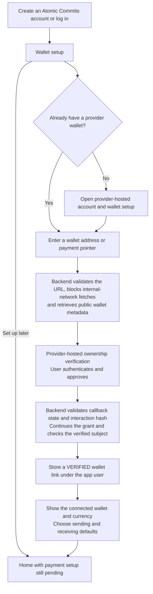
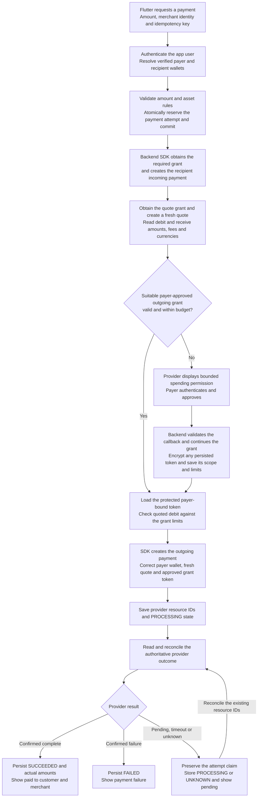
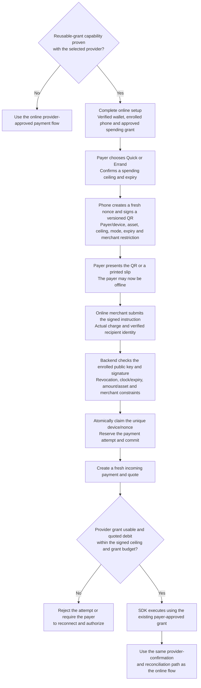

# Atomic Commits payment flows

These box-and-arrow flowcharts describe the intended Flutter/backend payment flow. The detailed [sequence diagram](payment-flows.mmd) is retained alongside this document.

**Status:** the production flows below are design targets. The current integration implements public wallet lookup and developer-client initialization. It has not yet executed a provider payment. The final section maps the target to the current development implementation.

## 1. Production target: signup and wallet setup



- Atomic Commits signup creates an **app identity**. Provider account creation uses the provider's own onboarding flow. We have not established a public API to automatically create Test Wallet consumer accounts.
- Repeat linking for additional wallets. The production app will obtain wallet addresses from verified per-user records in Supabase.
- Public metadata lookup establishes that an address resolves. Provider ownership verification establishes the user-to-wallet link.
- A verified wallet link and permission to spend are separate. App authentication is also separate from Open Payments authorization.
- The JWT migration is tracked in [issue #4](https://github.com/MasieJr/Atomic-Commits/issues/4). Native app login credentials will use platform-protected storage.

## 2. Production target: online payment



### Who owns the client and permission?

The backend can reuse a configured SDK client across app users. Its **developer signing key identifies Atomic Commits** to the provider. Each outgoing payment supplies the intended payer wallet and that payer's approved provider grant token.

```text
Shared backend client + payer A's wallet and grant -> payer A's payment
Shared backend client + payer B's wallet and grant -> payer B's payment
```

The provider holds and moves funds. Supabase stores app records and provider references.

### Amounts and outcomes

- Amounts use integer minor-unit strings with an explicit asset and scale.
- Compare debit limits with the provider's **quoted debit amount**, including applicable fees and currency conversion. Do not compare amounts in different currencies or scales directly.
- Commit the database reservation before making external provider calls. Keep database transactions short.
- API acceptance and a local database record are intermediate states. A paid state requires provider-confirmed completion.
- For an uncertain result, reconcile the existing attempt before initiating another debit. Provider-side idempotency support still needs to be established independently of app-side duplicate control.

## 3. Conditional production target: payer offline, merchant online

This flow depends on actual provider support for reusable, budget-limited outgoing-payment grants.



- **Quick:** at most 30 seconds. **Errand:** user-selected duration up to 25 minutes.
- The phone generates its own Ed25519 key pair. Its private key stays in secure device storage; the backend stores the public verification key and revocation metadata.
- This phone key is separate from the backend's Open Payments developer key and the provider's spending grant.
- One successful redemption consumes the credential, even when the actual charge is below its ceiling. The unused difference stays in the payer's provider wallet.
- Creating a QR does not reserve funds or guarantee a sufficient provider balance. If both devices are offline, a queued action remains pending.
- Before enabling real offline-payer redemption, prove one transfer and then two distinct payments using one approved aggregate-budget grant without a second consent prompt. Each payment needs its own incoming payment and quote.

## 4. Current development implementation

```mermaid
flowchart TD
    subgraph Lookup["IMPLEMENTED - temporary public lookup"]
        Command["npm run wallet:lookup"] --> Inputs["One/two command arguments<br/>or temporary sender/receiver environment values"]
        Inputs --> Normalize["Normalize payment pointers to HTTPS<br/>Validate the address format"]
        Normalize --> PublicClient["Create an unauthenticated SDK client"]
        PublicClient --> Fetch["Fetch public wallet metadata<br/>SDK validates the provider response"]
        Fetch --> Output["Print metadata with<br/>mode = temporary-integration-lookup"]
    end
    subgraph Signing["IMPLEMENTED - developer-client initialization"]
        Config["Server-only client wallet address,<br/>key ID and private-key file path"] --> Factory["createOpenPaymentsClient factory"]
        Factory --> Client["New signing-capable SDK client instance<br/>Created on each factory call"]
    end
```



The public lookup command uses the unauthenticated client. It does not call the signing-client factory or use the private key. Both public wallet metadata lookup and initialization with the matched registered developer key have been verified.

| Area | Production target | What we have in development |
| --- | --- | --- |
| Provider | A participating provider with agreed capabilities and onboarding | Interledger Test Wallet, simulated funds and manual account funding |
| Wallet selection | Verified per-user wallet links selected through the API | Temporary `SENDING_WALLET_ADDRESS_URL` and `RECEIVING_WALLET_ADDRESS_URL` inputs for the manual command |
| SDK identity | Backend-controlled integration credentials, reusable across users | A demo payer Test Wallet supplies the developer identity/key; the factory returns a new client on each call |
| App authentication | Agreed Flutter/API token contract and protected client storage | BCrypt passwords and PostgreSQL cookie sessions; JWT migration is tracked in issue #4 |
| Sensitive storage | Backend secret storage, encrypted persisted provider tokens and protected phone keys | Local `.env` and PEM files are plaintext and excluded from Git; provider-token persistence and phone-key enrollment are pending |
| Database | Runtime/migration configuration suited to the deployment | One verified-TLS Supabase connection; the configuration split is deferred in [issue #3](https://github.com/MasieJr/Atomic-Commits/issues/3) |
| Wallet linking | Provider ownership verification and stored verified links | Public metadata discovery only; the wallet-link API and its URL/SSRF controls are pending |
| Payment execution | Incoming payment, quote, approved outgoing grant, confirmed outcome and reconciliation | SDK setup only; the single-transfer and reusable-grant proofs are pending |
| Flutter onboarding | Signup followed by wallet-link/create/later setup | Existing payer/merchant UI; signup, wallet setup and payment API wiring are pending |
| Offline QR | Enrolled device, signed bounded credential, single-use redemption and provider settlement | Planned; no device enrollment or signed offline redemption is implemented |

### Relevant implementation files

- `backend/src/services/open-payments.ts` - URL normalization, SDK client configuration and public metadata lookup.
- `backend/src/commands/wallet-lookup.ts` - temporary command-line entry point.
- `backend/.env.example` - server-only developer settings and explicitly temporary two-wallet inputs.
- `backend/package.json` - the `wallet:lookup` build/run command.

The temporary sender/receiver settings belong to the manual integration workflow. Flutter users will link their own wallets through the app; they will not manage backend environment files or the backend developer key.
