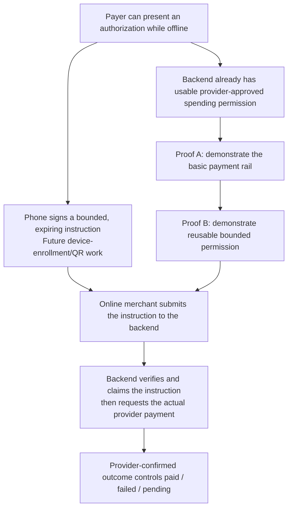
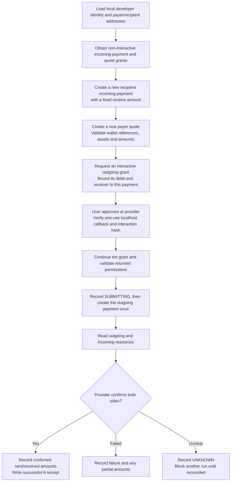
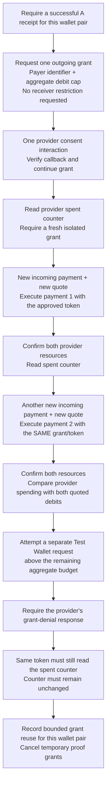
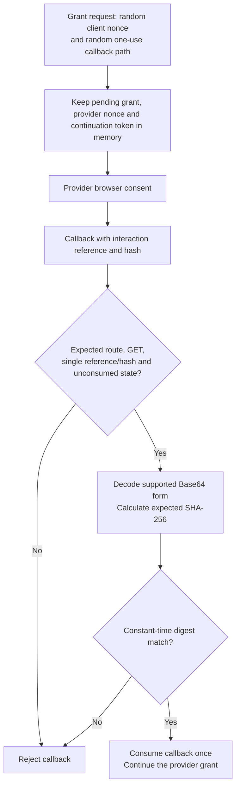
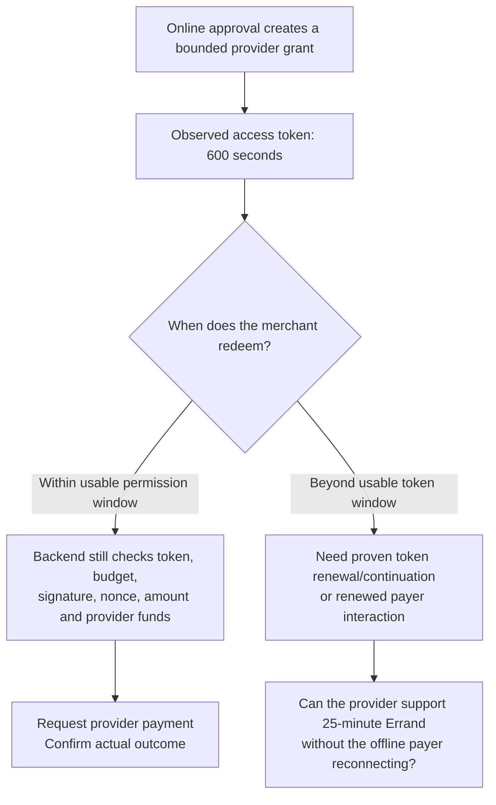

# Payment proofs and the theory behind them

This document records what the backend experiments demonstrate, why they matter, and their limits. Here, a **proof** means an empirical integration experiment against Interledger Test Wallet, using simulated funds. It is not a formal proof or a production-readiness claim.

- [Backend architecture and API boundary](backend-payments.md)
- Local agent handoff: `backend-agent-handoff.md` (not versioned)
- [Reproduction guide, including keys and tokens](payment-reproduction.md)
- [Product payment flowcharts](payment-flows.md)

## 1. The question we are answering

Can Atomic Commits obtain explicit provider permission while a payer is online, then initiate later provider payments without another payer interaction?

The intended offline-payer experience depends on that capability. A phone-generated signature can authenticate a payment instruction, but permission to debit the provider account still comes from the provider's grant. The merchant and backend remain online at settlement.



The current experiments exercise the provider-permission side. They do not yet implement the phone-signature or app-facing API side.

## 2. Three provider resources, separate grants

| Resource | Role in the payment | Relevant permission |
| --- | --- | --- |
| Incoming payment | A new receiving instruction at the recipient | Incoming-payment grant |
| Quote | Provider-quoted debit and receive amounts, including FX/fees | Quote grant |
| Outgoing payment | Instruction to the payer's provider to execute the payment | Payer-approved outgoing-payment grant |

The backend developer key signs provider requests. A provider access token authorizes a particular scope. These are separate inputs. The Open Payments SDK client is an object providing API methods; it is neither the app user nor an internal money balance.

Amounts are integer minor-unit strings, paired with `assetCode` and `assetScale`. With scale 2, `"185"` ZAR means 1.85 ZAR and `"10"` EUR means 0.10 EUR. Comparing these raw values across currencies would be incorrect. The quote provides the conversion relationship.

## 3. Proof A: establish the basic rail

### Hypothesis

The configured developer client can obtain the required grants and create a payer-approved Test Wallet transfer, then confirm both sides using provider resources.



### Actual success criteria

The implementation requires all of the following:

1. Resource wallet IDs, incoming-payment ID and quote ID match the intended attempt.
2. Provider-reported outgoing debit equals the quoted debit, with matching asset/scale.
3. The outgoing payment is not marked failed and its sent amount equals its debit amount.
4. The incoming payment is completed and its received amount meets the quote's receive amount in the expected asset.

Creating a resource, accepting a grant or printing a local success message is not enough. A failed outgoing payment may have partial sent/received amounts; the report retains those amounts and the command does not silently repeat the debit.

### Observed result

On **23 October 2026**, the provider confirmed **1.85 ZAR sent and 0.10 EUR received**. This demonstrates the configured cross-currency Test Wallet path. The rate is an observation from that quote, not a constant to hardcode.

## 4. Proof B: one grant, two payments

### Hypothesis

One explicitly approved outgoing-payment grant can authorize two separately prepared payments, using the same access token and staying within an aggregate debit cap.

The outgoing grant request deliberately omits a receiver. The script already knows the demo recipient's address from configuration, but it creates the B incoming-payment resources and quotes only after approval. That distinction matters: the grant is not pre-bound to one incoming-payment ID.



The script does not rotate the outgoing token or request another outgoing grant between B's two positive transfers. Incoming-payment and quote permissions are separate resource grants, not substitute outgoing spending permissions.

### Aggregate budget calculation

The provider-reported debit counter, not a cached app balance, is used when checking remaining permission:

```text
approved budget = 500 ZAR minor units
payment 1 debit = 185
payment 2 debit = 185
provider spent = 370
remaining permission = 500 - 370 = 130
negative-probe debit = 315
370 + 315 = 685, which exceeds 500
```

The negative probe's individual amount is below the original cap but above the remaining cap. Its rejection therefore exercises aggregate-budget enforcement rather than merely a per-payment maximum.

### Observed result

| Check | Result |
| --- | --- |
| Positive payments | Two distinct completed payments, each 1.85 ZAR sent / 0.10 EUR received |
| Outgoing grant/token | Same grant and token for both payments |
| Payer consent | One initial B spending approval, no second consent prompt between the two payments |
| Approved budget | 5.00 ZAR |
| Provider-reported spending | 3.70 ZAR |
| Excess request | 3.15 ZAR with only 1.30 ZAR remaining |
| Provider rejection | HTTP 403, code `403`, description `unauthorized` |
| Post-rejection counter | Still 3.70 ZAR, successfully read with the same token |
| Advertised access-token lifetime | 600 seconds |
| Cleanup | Temporary grant cancellation completed without warnings |

Rafiki maps its outgoing-payment `InsufficientGrant` error to HTTP 403 / `unauthorized`. The checker requires the relevant denial, no accepted outgoing ID, and a still-usable token with an unchanged counter. An arbitrary 403 elsewhere in the payment flow is not treated as success.

## 5. Callback theory and the encoding fix

The proof's loopback route includes an unpredictable value. A valid callback must also include one `interact_ref`, one hash, and the correct GNAP interaction digest.

```text
hash input = clientNonce + LF
           + providerNonce + LF
           + interact_ref + LF
           + exact initial grant endpoint URI
```

There is no trailing newline. The code calculates SHA-256 over the ASCII input, decodes the received digest and compares the 32 bytes in constant time. It accepts canonical Base64url and the padded Base64 emitted by the tested Rafiki implementation.



The first implementation was too strict about the digest's encoding. Supporting the provider's padded Base64 representation fixed interoperability; it did not bypass hash verification. The verifier also matched the official Open Payments example and rejected a changed digest.

## 6. Token lifetime versus the 25-minute vision

`access_token.expires_in = 600` was advertised by the provider. This is an access-token lifetime, not proof of the entire grant's maximum lifetime or of available refresh behavior.



The proof does not establish token rotation, renewal after expiry, a 25-minute offline journey, or permanent unattended access. Both proof commands cancel their temporary grants at the end of a resolved run, so historical receipts do not provide active spending permission.

## 7. Exact scope of the evidence

### Demonstrated

- Signed developer-client requests accepted by Test Wallet.
- A provider-approved, cross-currency transfer and provider-confirmed sent/received amounts.
- Two fresh payments using one outgoing grant/token after one approval.
- Provider spending counters consistent with the two quoted debits.
- An aggregate over-budget request rejected without increasing spending.
- Callback digest interoperability and bounded temporary grant cleanup.

### Not demonstrated

- A different merchant wallet, unrelated payer identities, or an independently owned production integration client.
- Another Open Payments provider, a South African bank connection, or real-money settlement.
- Token renewal/rotation, expiry recovery, or the complete maximum Errand lifetime.
- A physically disconnected phone, phone-held signing keys, offline QR generation or single-use merchant redemption.
- Verified app-user wallet links, app-facing payment endpoints, encrypted durable grant storage, or multi-worker recovery/concurrency.

The recipient address was known to the script. Omitting `receiver` from the grant and using new incoming resources is evidence for reusable permission; it is not an empirical multi-merchant test.

## 8. Evidence and session accounting

The successful receipts are local and Git-ignored:

- `backend/.env.payment-proofs/proof-a.json`
- `backend/.env.payment-proofs/proof-b.json`
- `backend/.env.payment-proofs/latest.json` and per-run JSON files

These contain provider references, amounts, statuses and redacted diagnostics. Grant/continuation tokens are not written to them.

One B run completed its two payments but the original checker incorrectly classified the provider's generic 403 as inconclusive. B was repeated after adapting the checker and adding the post-rejection counter confirmation. Across the session, **five positive transfers completed: 9.25 ZAR sent and 0.50 EUR received**. The rejected budget probes did not move funds. Failed/expired approval attempts did not submit an outgoing payment.

## 9. What the result means for the vision

The provider permission primitive needed for an unattended backend payment is demonstrably available in this specific Test Wallet setup. This supports continuing backend wallet-linking, grant management and payment API work.

It does not eliminate the need for customer setup, provider funding, device enrollment, a trustworthy merchant identity or an online backend/provider at redemption. The highest-priority product question is how a 25-minute credential remains redeemable when the observed provider token lasts 10 minutes. Further vision questions are kept in the local agent handoff; the [backend overview](backend-payments.md) covers the public architecture and scope.

## References

- [Official Node SDK and peer-to-peer example](https://github.com/interledger/open-payments-node/tree/main/examples/peer-to-peer)
- [Future-payment grants](https://openpayments.dev/guides/outgoing-grant-future-payments/)
- [Interaction hash verification](https://openpayments.dev/identity/hash-verification/)
- [Rafiki interaction callback implementation](https://github.com/interledger/rafiki/blob/main/packages/auth/src/interaction/routes.ts)
- [Rafiki outgoing-payment error mapping](https://github.com/interledger/rafiki/blob/main/packages/backend/src/open_payments/payment/outgoing/errors.ts)

Observed deployment behavior and the checked-in SDK lockfile take precedence over assuming that every future version or provider behaves identically.
