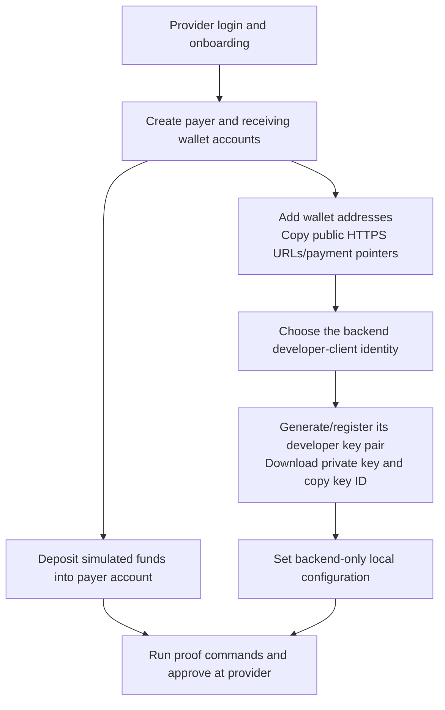
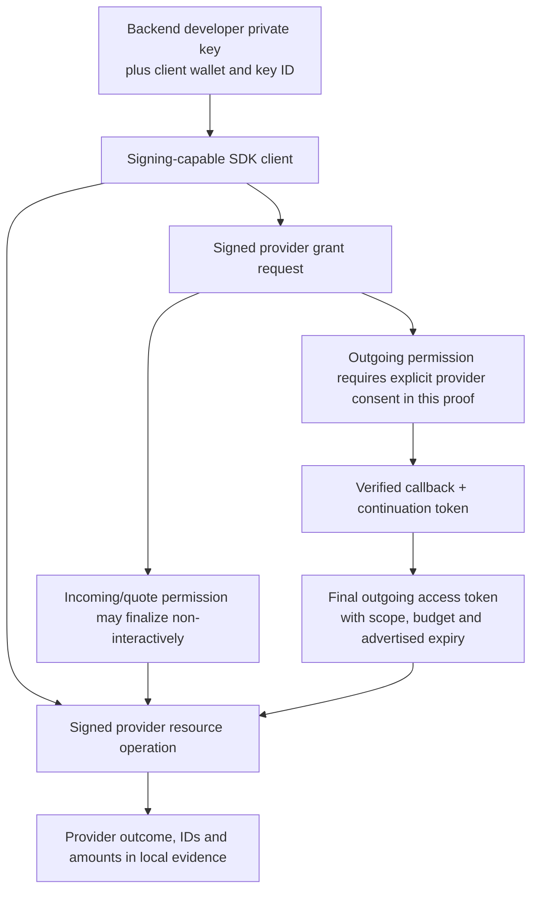
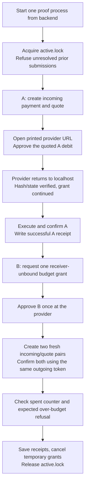

# Reproduce the backend payment proofs

This is a backend-only runbook. Flutter and the Flutter SDK are not required. The commands use Interledger Test Wallet and simulated funds, request actual provider consent, and can create new test transfers.

All values below are placeholders or public example amounts. Real private keys, passwords, cookies and provider tokens belong in local/protected configuration, not this document. Old approval links and historical receipts cannot recreate active permission.

- [Proofs/theory and observed results](payment-proofs.md)
- [Current API and backend architecture](backend-payments.md)
- [Product payment flowcharts](payment-flows.md)

## 1. Prerequisites and source state

1. Use the existing `MasieJr/Atomic-Commits` checkout with the payment-proof source files present. Inspect the working tree first; these files may be uncommitted until the owner approves a commit. Do not assume that cloning `main` alone provides them.
2. Use Node 22 LTS for the known setup; the package declares Node 20 or newer. The observed run used Node 22.16.0.
3. Open a terminal in `backend/`. Relative private-key/certificate paths and `.env.payment-proofs/` resolve from this working directory.
4. Install locked dependencies and build:

```sh
npm ci
npm run build
```

The installed SDK is `@interledger/open-payments` 7.4.0 in the current lockfile. Npm reported upstream `uuid` audit findings through that dependency. Record/evaluate dependency changes separately; do not force unrelated upgrades merely to reproduce the experiment.

**The payment CLI does not need PostgreSQL, app login or the app HTTP server running.** Those are needed for the existing app auth endpoints, covered in the optional section below.

## 2. Create the provider-side accounts and addresses

At [Interledger Test Wallet](https://wallet.interledger-test.dev/):

1. Create/verify the provider login and complete its test-environment onboarding.
2. Create a payer wallet account and a separate receiving wallet account. Use separate provider users when validating unrelated-user behavior; the observed proof did not establish that broader scenario.
3. Add a wallet address to each account. Copy the payment pointer or full HTTPS address, not the dashboard URL.
4. Open **Accounts**, select the payer account, choose **Deposit**, and add simulated funds. For the observed defaults, at least 10 test ZAR covers the three positive payments in a combined run and makes the over-budget check independent of a low balance.
5. The observed pair was ZAR/scale 2 to EUR/scale 2. Other assets or current quotes can produce different debit amounts. The recipient can start without funding.



Three roles are configured: developer client, payer and receiver. The developer client can use one of the two demo wallets, as in the current setup; this does not require a third wallet for the initial proof. A dedicated app-owned identity is a separate production validation step.

## 3. Obtain and verify the developer key

In the provider dashboard, open **Settings -> Developer Keys**, select the account used as the backend client, and generate/register an Ed25519 key pair. The provider downloads a private-key file and displays a key ID/public key.

- Retain the private file on the backend machine. One suggested ignored filename is `backend/.env.open-payments.key`.
- Copy the displayed **key ID** separately. A PKCS#8 PEM private file does not contain the wallet address or the provider-assigned key ID.
- Download counters such as `private (1).key` and `private (2).key` have no stable payer/merchant meaning. Match their public keys to the registration, rather than guessing from the filename.
- The backend developer key is not a customer's phone key, app password, app session secret or JWT signing key.

The Test Wallet download and local `.env` are plaintext development files. Git exclusion is not encryption. The current proof code loads an unencrypted key file; it does not implement an encrypted-PEM passphrase setting or a secret-manager integration.

## 4. Local payment-proof configuration

Create `backend/.env` from `backend/.env.example` and preserve any existing auth/DB configuration. Set these values using your own provider registration:

```dotenv
NODE_ENV=development

# Backend integration identity - paired with the registered key below
CLIENT_WALLET_ADDRESS_URL=https://ilp.interledger-test.dev/<client-wallet>
KEY_ID=<provider-assigned-key-id>
PRIVATE_KEY_PATH=.env.open-payments.key

# TEMPORARY operator inputs - not the future per-user app wallet store
SENDING_WALLET_ADDRESS_URL=https://ilp.interledger-test.dev/<payer-wallet>
RECEIVING_WALLET_ADDRESS_URL=https://ilp.interledger-test.dev/<receiver-wallet>

PAYMENT_PROOF_RECEIVE_AMOUNT_MINOR=10
PAYMENT_PROOF_BUDGET_MINOR=500
PAYMENT_PROOF_CALLBACK_PORT=3999
PAYMENT_PROOF_CONSENT_TIMEOUT_SECONDS=600
PAYMENT_PROOF_SETTLEMENT_TIMEOUT_SECONDS=90
```

Replace every angle-bracket placeholder. A quoted absolute path is also supported when the private file is elsewhere, including a Windows path containing spaces. Keep the full HTTPS client address in this configuration so direct diagnostic SDK calls use the correct URL.

### Setting meanings

| Setting | Meaning |
| --- | --- |
| `CLIENT_WALLET_ADDRESS_URL` | Public identity whose `/jwks.json` contains the client signing public key |
| `KEY_ID` | That public key's provider-registered identifier |
| `PRIVATE_KEY_PATH` | Local server private-key file corresponding to that public key |
| `SENDING_WALLET_ADDRESS_URL` | Manual payer input, replaced by a verified user wallet record in the app design |
| `RECEIVING_WALLET_ADDRESS_URL` | Manual receiving input, replaced by authorized recipient records in the app design |
| `PAYMENT_PROOF_RECEIVE_AMOUNT_MINOR` | Positive receive amount per payment, in the recipient's asset/scale |
| `PAYMENT_PROOF_BUDGET_MINOR` | A's maximum allowed quoted debit and B's requested aggregate outgoing cap, in the payer's asset/scale |
| Callback port | Loopback listener, valid configured range 1024-65535 |
| Consent timeout | Local wait, configured 30-900 seconds; it does not set provider token expiry |
| Settlement timeout | Local reconciliation window, configured 10-300 seconds |

With the observed EUR/ZAR pair and scale 2, `10` means 0.10 EUR received and `500` means a 5.00 ZAR B budget. The code obtains a quote rather than using the observed 1.85 ZAR as a fixed rate. No outgoing cap is silently increased to make a quote fit.

Confirm local files are ignored, from `backend`:

```sh
git check-ignore -v -- .env .env.open-payments.key .env.payment-proofs/latest.json
```

## 5. Keys, tokens and identifiers: complete inventory

| Item | Where it comes from | Where/current use | Lifetime and client exposure |
| --- | --- | --- | --- |
| Developer private key | Generated/registered through provider developer settings | Server file loaded by SDK to sign requests | Long-lived until replaced/revoked; never supplied to an app client |
| Developer public key/JWKS | Registered at the client wallet's `/jwks.json` | Provider verifies HTTP signatures | Public; paired by `KEY_ID` |
| `KEY_ID` | Provider registration UI/JWKS | Select matching verification key | Public identifier, not spending authority |
| Client/payer/receiver wallet address | Provider wallet setup | Public discovery and operation targeting | Public identifier; metadata lookup is not user ownership verification |
| Incoming-payment access token | Incoming grant request | Authorizes recipient resource creation/read/complete | Opaque secret, kept in memory; not an app JWT |
| Quote access token | Quote grant request | Authorizes quote creation/read | Opaque secret, kept in memory |
| Continuation token | Pending/final grant's `continue.access_token.value` | `Authorization: GNAP ...` for continuation/cancellation | Opaque secret, updated from continuation responses and kept in memory |
| Outgoing-payment access token | Finalized payer-approved grant | Resource calls for payer debit/read/spent counter | Opaque secret; observed `expires_in` was 600 seconds |
| Token `manage` URI | Final access-token response | Potential token management endpoint | A reference, not sufficient authority alone; rotation was not exercised |
| Grant continuation URI | Grant's `continue.uri` | Continue/cancel this grant | Reference requiring the matching secret token and request authentication |
| Client/provider nonces, `interact_ref`, hash | Interactive grant and callback | Verify and finish one consent interaction | Transient workflow data; keep out of general app DTOs/logs |
| Incoming payment ILP shared secret | Provider incoming-payment methods | Provider/payment-rail parameters | Sensitive resource detail; the proof does not print full raw incoming objects |
| `SESSION_SECRET` | Backend-generated app configuration | Sign current Express session cookies | Server-only; unrelated to provider signing or grants |
| `atomic.sid` app cookie | Existing app register/login endpoints | Authenticate an app user to our API | Private app credential; server cookie max age is currently two hours |
| App JWT/signing material | Future issue #4 work | Planned app authentication | Not currently implemented/configured by these proofs |
| Phone Ed25519 private key | Future client-side device enrollment | Sign offline payment instructions | Phone-held, separate from developer key; not implemented |
| Phone public key/device ID | Future enrollment API | Backend verification and revocation | Public key bound to an authenticated owner; not implemented |
| Persistent-token encryption key | Future backend secret-storage design | Protect stored provider credentials after restart | Dedicated backend secret, not reused from passwords/session/developer/phone keys; not implemented |

Provider resource APIs use **`Authorization: GNAP <provider-token>` plus SDK request signing**. Planned app JWTs would use **`Authorization: Bearer <app-token>` to our API**. Current app auth uses its cookie. These credentials are not interchangeable.



You do not manually invent or paste provider access tokens into `.env`. The commands obtain fresh tokens after the relevant grant flow. They are held only in memory and temporary grants are cancelled at the end of a resolved run. Receipts contain no reusable provider tokens.

## 6. Check wallet metadata and the key registration

Public lookup, using configured addresses:

```sh
npm run wallet:lookup
```

Or pass one/two explicit pointers. Single quotes preserve `$` in PowerShell:

```powershell
npm run wallet:lookup -- '$ilp.interledger-test.dev/<payer-wallet>' '$ilp.interledger-test.dev/<receiver-wallet>'
```

Check `assetCode`, `assetScale`, `authServer` and `resourceServer`. The result does not prove an Atomic Commits user owns the address or has spending permission.

Optional registration diagnostic, from `backend`, prints no private key:

```powershell
node -e "require('dotenv').config(); const { createUnauthenticatedClient } = require('@interledger/open-payments'); const { loadKey } = require('@interledger/http-signature-utils'); const { createPublicKey } = require('node:crypto'); (async () => { const local = createPublicKey(loadKey(process.env.PRIVATE_KEY_PATH)).export({format:'jwk'}); const client = await createUnauthenticatedClient({logLevel:'silent',validateResponses:true}); const jwks = await client.walletAddress.getKeys({url:process.env.CLIENT_WALLET_ADDRESS_URL}); const matches = jwks.keys.some(key => key.kid === process.env.KEY_ID && key.kty === local.kty && key.crv === local.crv && key.x === local.x); if (!matches) throw new Error('Private key, key ID and client wallet registration do not match.'); console.log('Registered public key matches the configured private-key file.'); })().catch(error => {console.error(error.message);process.exitCode=1;});"
```

The helper package is already installed through the locked SDK dependency. This checks public-key correspondence; it does not create a bank account or approve spending.

## 7. Run A, B or both

The complete sequence:

```sh
npm run payment:proofs
```

Individual modes:

```sh
npm run payment:proof-a
npm run payment:proof-b
```

B requires the local successful A receipt to match the configured payer and receiver. That is an operator progress gate, not production payment authorization.



### Consent behavior

- Open the printed approval URL on the **same computer that runs the CLI**. A localhost callback opened on a different phone/computer points to that other machine.
- Authenticate as the owner of the payer wallet and approve the displayed amount/budget. Do not reuse an old approval URL from a previous run.
- Wait for the localhost page to confirm verification. The terminal then continues automatically; there is no manual step that bypasses callback verification.
- A requests a quote-sized debit cap, receiver-bound to its incoming resource. B requests one aggregate debit cap without naming a receiver, then creates its two receiving resources/quotes after approval.
- The B negative probe deliberately requests more than the remaining grant allowance in Test Wallet. The required outcome is provider rejection, no outgoing resource acceptance, and an unchanged counter read with the same token.
- Each rerun can make new positive test payments after fresh provider approval. It is not a dry-run command.

## 8. Inspect evidence

Open `backend/.env.payment-proofs/` locally:

| File | Meaning |
| --- | --- |
| `proof-a.json` | Last successful A receipt for its wallet pair |
| `proof-b.json` | Last successful B receipt, including reuse and budget evidence |
| `latest.json` | Most recent run progress/outcome; can be A, B or combined |
| `<run-id>.json` | Original per-run evidence, including failures |
| `active.lock` | PID marker preventing overlapping runs |

For a successful B receipt, inspect `status`, `sameGrantAndToken`, `interactiveApprovals`, `providerSpentDebitAmount`, distinct incoming/quote/outgoing IDs, and `budgetEnforcement.spentBefore` / `spentAfter`.

The observed run used 3.70 ZAR under a 5.00 ZAR budget and rejected an extra 3.15 ZAR with 1.30 ZAR remaining. Amounts can change with quotes, so reproduce the invariants rather than asserting that a current quote must cost 1.85 ZAR.

The current successful receipts are not resumable authority: tokens are not saved and the grants were cancelled. For a new run, obtain new consent/tokens through the command.

## 9. Troubleshooting and interrupted runs

| Symptom | Meaning and next check |
| --- | --- |
| Missing config | Check backend working directory, `.env` values and placeholder replacement |
| Invalid client/signature | Match private file, client wallet JWKS and `KEY_ID`; check the machine clock and current key registration |
| Callback 404 or connection refused | Use the current link on the CLI computer; check the process is still running, callback port is free and the interaction has not timed out |
| Callback verification error | Preserve the exact callback query. The verifier supports padded Base64/Base64url, rejects duplicates and requires the correct nonce/reference/grant URI digest |
| Grant rejected/denied | Record the protocol step and provider status/code; do not bypass consent or remove limits |
| Quote failure or too-expensive debit | Confirm actual asset metadata, provider FX support and current quote. Choose an explicit new small amount/budget if needed; the program does not silently raise it |
| Positive payment 403 | This is a payment failure, not the expected negative probe. Check live grant scope/expiry and provider details |
| Negative probe 403 / `unauthorized` | Expected only in its budget context, with no accepted outgoing ID and an unchanged same-token counter |
| Insufficient funds | Deposit simulated funds into the actual payer account, not merely the receiving account |
| Expired token or quote | These lifetimes are independent of the local wait settings. The proof can refresh a quote within the already-approved budget; it does not silently rotate the outgoing token |
| Existing `active.lock` | Inspect its PID, report and provider history; do not delete a live run's lock |
| `SUBMITTING`, `PROCESSING` or `UNKNOWN` from an interrupted run | Reconcile before a fresh debit. There is no implemented durable-token resume command |

After a crash, a report can be conservatively unresolved even if the provider later completes payment. If the process ended, the in-memory read token is gone. Use provider history/authorized support or a separately authorized read mechanism, then deliberately resolve the operator state. Do not edit a receipt to `PASSED` or discard unresolved evidence simply to unblock another payment.

## 10. Optional: run the existing app API/auth backend

This section is separate from the provider CLI. Use the Supabase dashboard's actual connection information and CA download. The working development setup uses the **session pooler on port 5432** with verified TLS. The migration/runtime URL split remains issue #3.

Additional local `.env` values:

```dotenv
PORT=3000
SESSION_SECRET=<at-least-32-random-characters>
DATABASE_URL=postgresql://postgres.<project-ref>:<url-encoded-password>@<pooler-host>:5432/postgres?sslmode=verify-full&sslrootcert=.env.supabase-ca.crt
```

Save the public database CA certificate at the configured path. Percent-encode reserved characters in the password. The backend/private configuration is not a mobile app configuration file.

An operator can generate a fresh session secret locally:

```powershell
node -e "console.log(require('node:crypto').randomBytes(32).toString('hex'));"
```

Keep the resulting value in local/protected configuration. Then:

```sh
npm run db:migrate
npm run dev
```

Current endpoints are `GET /health`, `POST /api/auth/register`, `POST /api/auth/login`, `GET /api/auth/me` and `POST /api/auth/logout`. App register/login issue a cookie rather than a JWT. Use a client cookie jar for current protected auth calls. Auth rate limits can produce HTTP 429 after repeated attempts; wait for the window rather than disabling the limiter.

The proof callback on 3999 remains a temporary separate listener. Payment resources described in the [backend API overview](backend-payments.md) remain proposals and will not work until implemented.

## 11. Production differences to retain

- Sender/receiver selection comes from verified app-user/merchant records, not two global environment variables.
- Provider credentials needed after a restart require protected persistent storage; the current CLI keeps them only in memory.
- The API needs persisted callback state, authorization, idempotency and reconciliation, not the proof's global file lock.
- Production browser callbacks use the backend's reachable HTTPS URI. Clients receive a safe workflow/result reference, never provider secret tokens.
- Phone-generated signing keys, native secure storage and Flutter screens are consumer-team work against the backend contract, not prerequisites for running this backend-only experiment.
